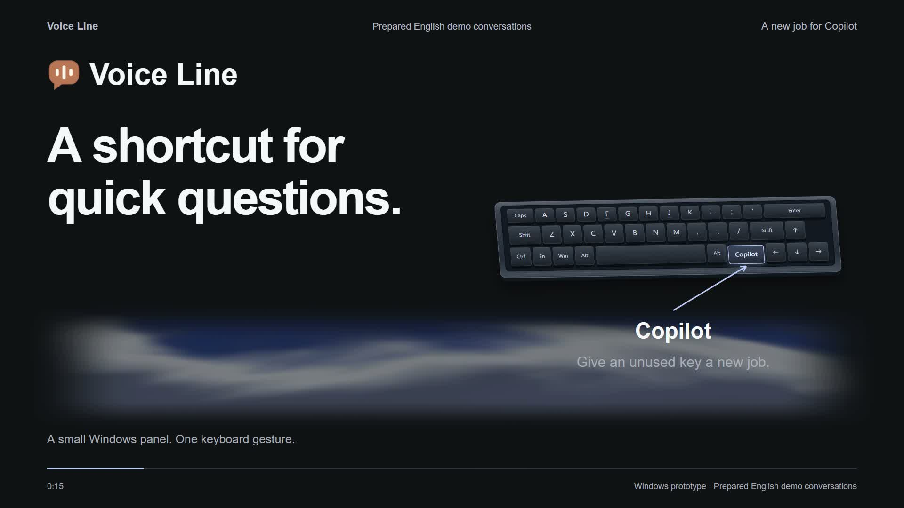
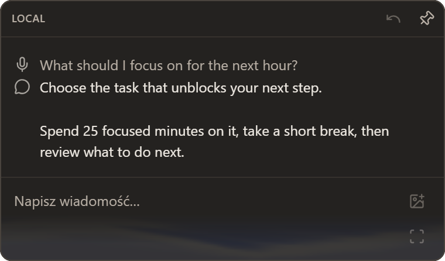
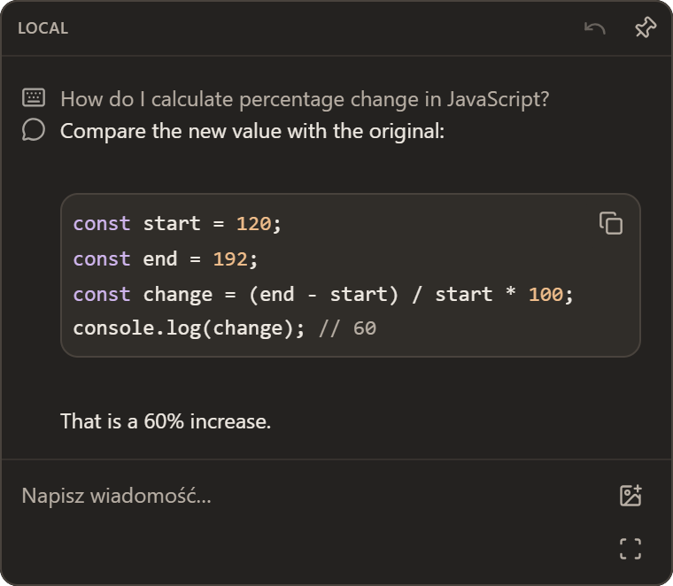

# Voice Line

A Windows desktop prototype for quick voice and text conversations with Codex. Hold the Copilot key to speak, release it to send, and hear the answer while reading along in a small Electron panel. Press again to interrupt. Tap the key to type a question and receive a silent reply.

LOCAL mode uses whisper.cpp for speech recognition and Windows SAPI or Piper for speech playback. **Codex answers online** using the existing signed-in account; LOCAL describes speech processing. The current assistant instructions request Polish answers. The repository remains private and is not a packaged public release.

[](docs/media/voice-line-explainer-en-captioned.mp4)

[Watch/download the captioned explainer (MP4, 2:12, 9.6 MB)](docs/media/voice-line-explainer-en-captioned.mp4) · [Transcript and media provenance](docs/media/README.md)

The film and screenshots use the production interface with prepared English examples and edited timing. They demonstrate the workflow rather than measured latency; the native controls remain Polish.

<table>
<tr><th>Voice answer</th><th>Code in a silent text reply</th></tr>
<tr><td></td><td></td></tr>
</table>

## What it does

- Voice questions, typed follow-ups, streamed answers and immediate interruption.
- One PNG, JPEG or WebP attachment, clipboard bitmap, or selected screen region per question.
- Code blocks with copying, explicit `/image` requests and image variant galleries.
- Current/previous conversation history and Markdown export with embedded images.
- A terminal interface using the same conversation and voice runtime as Electron.

## Windows requirements

| Requirement | Purpose |
| --- | --- |
| Windows 11, PowerShell 5.1 | Native keyboard hook, SAPI and desktop integration. Other operating systems are not supported. |
| Node.js **22.18.0 or newer** and npm | Direct TypeScript execution and dependency installation; use a maintained Node release. |
| Codex CLI with its native Windows runtime (`codex.exe` on `PATH` or a standard npm installation) and an existing login | Online answers through `codex app-server`; custom `.cmd`/`.bat` wrappers are rejected. `CODEX_MODE=cli` is an optional exec fallback. |
| FFmpeg with DirectShow support and an accessible microphone | Voice recording. Configure the actual executable when `PATH` resolves a launcher/shim. |
| whisper.cpp `whisper-server.exe` and a multilingual GGML model | Default local recognition. Keep the server beside `WHISPER_BIN`, put it on `PATH`, or set `WHISPER_SERVER_BIN`. `STT_MODE=cli` and the benchmark also need `whisper-cli.exe`. |
| A Polish Windows SAPI voice, or Piper plus a voice model and FFplay | Local speech playback. Piper and model binaries are separate downloads. |

English-only Whisper `.en` models cannot transcribe Polish. Install [whisper.cpp](https://github.com/ggml-org/whisper.cpp) and its model separately; this repository does not bundle or automatically download them. See the [Piper setup](docs/CONFIGURATION.md#try-piper-tts) for neural speech.

Default LOCAL usage does not need an `OPENAI_API_KEY` when the Codex account is already signed in. Account access, included usage and limits depend on the account; requests consume the applicable allowance. See [Codex authentication](https://learn.chatgpt.com/docs/auth?surface=cli). Experimental realtime is a separate API-key path described below.

## Configure and run

Run these commands in PowerShell from the existing repository root:

```powershell
npm.cmd ci
if (-not (Test-Path .env)) { Copy-Item .env.example .env }
npm.cmd run diagnose:devices
npm.cmd run diagnose:keys
```

Dependency installation downloads Electron's runtime unless that download is explicitly disabled. The diagnostics list microphone devices and observe key events without starting Codex. Hold/release Copilot and use the virtual key that stays down for the whole hold; F23 is often `134`, but hardware varies.

Edit the ignored `.env` with your device name and local paths:

```dotenv
MIC_DEVICE=Your exact DirectShow microphone name
WHISPER_BIN=C:\tools\whisper\whisper-cli.exe
WHISPER_MODEL=C:\models\ggml-small.bin
COPILOT_VK=134
# Optional if FFmpeg is not on PATH:
# FFMPEG_BIN=C:\tools\ffmpeg\bin\ffmpeg.exe
```

Sign in with `codex login` if necessary, then start the desktop app:

```powershell
npm.cmd start
```

The panel starts hidden. Hold Copilot for at least 250 ms to ask by voice, or tap to compose. Enter sends text, Shift+Enter adds a line, Escape hides the panel, and `Ctrl+Shift+N` starts a new conversation. Use **Zakończ** in the tray to shut down services; closing the panel only hides it. Missing speech services leave text input available. Restart after changing `.env`.

Use `npm.cmd run start:cli` for the terminal interface or `npm.cmd run preview:desktop` for an isolated visual preview with sample content and no microphone, keyboard hook or Codex calls. In Git Bash, use `npm` instead of `npm.cmd`.

| Setting | Default and behavior |
| --- | --- |
| `VOICE_MODE` | `local`: local Whisper and SAPI/Piper. `realtime`: experimental online audio, separate API authentication/billing. |
| `CODEX_MODE` | `app-server`; `cli` selects the exec answer fallback independently of the terminal interface. |
| `CODEX_MODEL`, `CODEX_EFFORT` | Existing Codex model configuration unless overridden; app-server effort defaults to `low`. |
| `TTS_MODE`, `VOICE`, `TTS_RATE` | `sapi`, an installed Polish voice, rate `2`; set `TTS_MODE=piper` and Piper paths for neural speech. |
| `STT_MODE`, `STT_LANGUAGE` | Persistent Whisper `server`, recognition language `pl`. |
| `APP_DATA_DIR` | `%LOCALAPPDATA%\VoiceLine`; private conversation/image data and desktop profile. |
| `SAVE_AUDIO` | Unset: temporary question WAV files are removed after processing. `1` keeps them for diagnosis. |

All settings and detailed controls are in [.env.example](.env.example) and the [configuration reference](docs/CONFIGURATION.md).

## Architecture and data

The Electron host owns native windows and imports; its Node worker owns the shared runtime and conversation state. The CLI uses that same runtime directly. `ApplicationController` coordinates recording, recognition, provider turns, speech, cancellation and retention; the LOCAL and realtime engines implement a common contract. See the [architecture and module map](docs/ARCHITECTURE.md).

Conversation context expires after two minutes without a successful answer; the previous-conversation control can restore retained history. Registered application history and unreferenced image artifacts are cleaned after 24 hours of inactivity. Export a conversation as Markdown to keep it beyond automatic cleanup.

Speech audio stays local in LOCAL mode, while transcripts, context and attached images go to Codex. Realtime also uploads recorded audio. The interactive voice process keeps the microphone open and discards samples outside recorded questions. Application data and Markdown exports contain readable conversation content. `start:debug` prints raw Codex replies, including possible inline image/audio data, to the terminal.

Run **one host per `APP_DATA_DIR`**. The desktop app and CLI do not coordinate concurrent writes across processes. Codex's read-only filesystem policy also does not disable the account's configured tools or MCP integrations; review that configuration before using sensitive data.

## Development and verification

```powershell
npm.cmd run check             # TypeScript checks, then isolated unit tests
npm.cmd run test:integration  # Local simulated backends; native dependencies required
npm.cmd run test:desktop      # Electron smoke; isolated data, screenshots retained
npm.cmd run test:keyboard     # Windows native hooks and synthetic F24/F22 events
```

| Check | Scope and prerequisites |
| --- | --- |
| `typecheck` | `tsc --noEmit` for TypeScript and selected Electron JavaScript; type stripping alone does not check types. |
| `test` | Discovered unit files under `tests/unit/`, with disposable app/Codex homes and no production `.env`. |
| `test:integration` | Speaker worker plus installed Codex wire tests using local simulated providers and dummy credentials; Codex and FFplay must be available. These are not live inference tests. |
| `test:desktop` | Real Electron host and renderer with fixture services; no microphone or Codex calls. Captures remain in `.app-data/test-results/desktop-<id>/`. |
| `test:keyboard` | Native Windows hooks and injected test-key events; verifies suppression and cleanup rather than the physical Copilot key. |

There is **no build, bundling or installer script**. The application runs source files directly; `typecheck` is a no-emit validation step. CI runs locked dependency installation and automated checks; it does not certify the microphone, installed speech models, account access or a real paid realtime conversation. See the [readiness report](docs/READINESS.md) for recorded results and [verification flows](VERIFICATION-FLOWS.md) for manual scenarios.

Select a test with `npm.cmd test -- test-app-storage.ts`. The `probe:imagegen` and `probe:image-history` scripts are explicit account-connected experiments, excluded from normal tests; some modes consume quota. See [diagnostics and command details](docs/CONFIGURATION.md#application-and-development-commands).

## Limitations and publication readiness

- Windows prototype with Polish controls/instructions, manual native dependencies and no signed installer or update mechanism.
- Physical Copilot behavior and speech quality depend on keyboard, microphone, voices and model configuration. Native realtime methods are experimental and version dependent; the reference records development observations from Codex CLI 0.161.0. End-to-end realtime needs a valid API key and separate API usage.
- Some natural-language image requests can return an incomplete answer or claim success without an image. Use `/image <description>` to select the explicit generation path.
- Attachments are limited to one image per question and 32 MiB before/after conversion. PDF/DOCX imports and continuous screen monitoring are unsupported; old image pixels are resent only when explicitly attached again.
- History is temporary. Storage, audio kept by `SAVE_AUDIO=1`, debug output and exports require care when sharing.
- No project license has been selected. Public release also requires a decision about media redistribution/attribution and resolution of the [security/history review](docs/SECURITY-REVIEW.md). The repository remains private.
