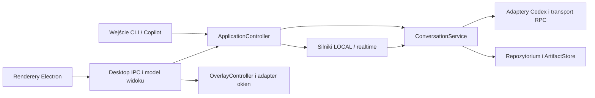

# Voice Line — przegląd przed dalszym rozwojem

Data: 10 października 2026. Zakres: kod aplikacji, konfiguracja, skrypty, testy oraz kontrakty z README.md, DESIGN.md i VERIFICATION-FLOWS.md. Przegląd obejmuje Electron, CLI, klawiaturę, nagrywanie, LOCAL/realtime, Codex, historię, obrazy i eksport. Początkowy przegląd nie zmieniał kodu produkcyjnego. Następnie wdrożono opisane na końcu uporządkowanie skryptów, testów i ich izolacji; pozostałe ustalenia są nadal rekomendacjami.

## Ocena

Aplikacja ma sensowne fundamenty i nadaje się do stopniowego refactoru. Największy koszt kolejnych funkcji wynika z rozproszonej odpowiedzialności za cykl życia operacji i zapis rozmowy. Ta sama czynność przechodzi przez worker, provider, sesję, retencję, Electron main i renderer, a każdy z tych elementów utrzymuje część własnego stanu.

Najpierw warto poprawić odporność na awarie i utrwalić kontrakty. Sam podział dużych plików nie usunie znalezionych problemów. Nie widzę w tym przeglądzie uzasadnienia dla zmiany frameworka UI, przepisywania aplikacji ani natychmiastowej migracji historii do bazy danych.

## Najważniejsze ustalenia

P1 oznacza awarię procesu lub zablokowanie podstawowej funkcji, którą warto naprawić przed kolejną większą funkcją. P2 oznacza błąd warunkowy albo istotną lukę odporności. Podatności na współbieżność, których osiągalności w normalnym UI nie wykazano, są opisane osobno.

| ID | Priorytet | Ustalenie | Miejsce |
| --- | --- | --- | --- |
| F01 | P1 | Błąd pipe Codexa może zakończyć worker | src/codex-app-server.ts:184 |
| F02 | P1 | Uszkodzona poprzednia historia może zablokować start | src/conversation-session.ts:47 |
| F03 | P2 | Retry nie działa po nieudanym spawn silnika | electron/orb-main.cjs:117, :283 |
| F04 | P2 | Timeout tury pozostawia nieustalony stan operacji | src/codex-app-server.ts:283, :319 |
| F05 | P2 | Uszkodzony indeks innego trybu blokuje sprawny tryb | src/conversation-retention.ts:57 |
| F06 | P2 | Whisper nie resetuje stanu startup po stop/awarii | src/stt/transcriber.ts:44, :91 |
| F07 | P2 | Eksport może zniszczyć wcześniejszy plik przy błędzie zapisu | electron/orb-main.cjs:88 |
| F08 | P2 | Nieudany zapis sesji pozostawia zmieniony stan w pamięci | src/conversation-session.ts:105 |
| F09 | P2 | Natywny hover kulki jest przesunięty o 8 px | electron/overlay-pointer.cjs:8 |
| F10 | P2 | Parser RPC myli request serwera z odpowiedzią | src/codex-app-server.ts:208 |

### F01 — obsłużyć awarię strumienia, zanim zakończy worker

`send()` sprawdza proces i `stdin.destroyed`, po czym wywołuje `stdin.write()` bez obsługi asynchronicznego błędu strumienia. Listenery `child.error` i `child.close` nie przejmują zdarzenia `stdin.error`. Jeżeli app-server zamknie pipe między sprawdzeniem a zapisem, Node może zakończyć worker przez nieobsłużone `EPIPE`.

Dowód: harness offline podstawił `Writable` zwracający asynchroniczne `EPIPE`; proces zakończył się kodem 1 i komunikatem `Unhandled 'error' event`. Nie uruchamiano rzeczywistego Codexa w tej reprodukcji.

Zmiana: wydzielić transport JSON-RPC, który obsługuje błędy wszystkich strumieni, odrzuca oczekujące requesty i emituje jedno zdarzenie rozłączenia. Test regresji: awaria podczas write, podczas oczekiwania na odpowiedź i podczas zamykania; worker pozostaje zdolny opublikować kontrolowany błąd.

### F02 — uszkodzenie jednej rozmowy nie powinno blokować całej aplikacji

Konstruktor `ConversationSession` obsługuje błędy metadanych, ale późniejsze wczytanie bieżącego i poprzedniego `<id>.json` odbywa się poza tym recovery. `readLocalHistory()` przekazuje błędy JSON i walidacji dalej. Uszkodzona poprzednia rozmowa blokuje `createAppStorage()` nawet wtedy, gdy użytkownik chce rozpocząć nową.

Dowód: w świeżym katalogu tymczasowym utworzono metadane poprzedniej rozmowy i niepoprawny JSON jej historii; konstrukcja storage rzuciła wyjątek. Istniejący test uszkodzonych metadanych nie obejmuje tego przypadku.

Zmiana: jawne ładowanie po konstrukcji i wynik `loaded/missing/corrupt`; odizolować uszkodzoną rozmowę i zachować jej plik do odzyskania. Nie zastępować błędnego pliku pustą historią bez śladu. Testy: bieżąca/poprzednia historia, błędny JSON, `[null]`, niepoprawne referencje obrazów i historia starsza niż retencja.

### F03 — supervisor procesu powinien obsłużyć również nieudany spawn

Electron zapisuje `engine = child`. Handler `error` pozostawia tę referencję, a sprzątanie następuje tylko na `exit`. Retry wysyła do starego obiektu `shutdown` i oczekuje na jego `exit`. Przy `ENOENT` nie ma uruchomionego procesu, a zdarzenie `exit` może w ogóle nie wystąpić; `close` występuje po błędzie spawn. Potwierdza to [kontrakt ChildProcess w Node.js](https://nodejs.org/api/child_process.html#event-close).

Dowód: reprodukcja na nieistniejącym executable dała `error/close`, bez `exit`; późniejsze `send` zgłosiło `ERR_IPC_CHANNEL_CLOSED`.

Zmiana: jeden supervisor z `starting/running/stopping/stopped`, sprzątaniem na `close`, sprawdzaniem IPC i pojedynczym restartem. Listenery starego procesu powinny być odrzucane według tożsamości instancji. Testy: brak binary, rozłączenie IPC, śmierć procesu i dwa szybkie retry.

### F04 — odrzucenie Promise nie oznacza zakończenia tury na serwerze

Watchdog 300 s wysyła interrupt i odrzuca lokalne `completion`. `finally` czyści `this.turn` tylko wtedy, gdy nie otrzymano ID tury. Następne wywołanie ignoruje odrzucenie wcześniejszego `completion` i może rozpocząć kolejną turę przed potwierdzeniem zakończenia starej.

Dowód: w harnessie skrócono wyłącznie watchdog do 20 ms. Po timeout pozostał `turn_1`, a drugie `respond()` wysłało `turn/start` dla `turn_2` bez wcześniejszego `turn/completed` pierwszej tury. Reakcja prawdziwego backendu zależy od jego stanu; nie potwierdzono, że zawsze zaakceptuje oba wywołania.

Zmiana: jawne `running/cancelling/finished/disconnected` i ograniczony czas oczekiwania na zakończenie interrupt. Gdy stan zewnętrznej operacji pozostaje nieznany, odzyskać połączenie przed kolejną turą. Testy: brak odpowiedzi na interrupt, późne `turn/completed`, kolejna prośba po deadline i reset w tym oknie.

### F05 — maintenance ma za duży wpływ na dostępność odpowiedzi

Retencja czyta indeksy LOCAL, realtime i ImageGen podczas sprawdzania referencji. Błędny indeks nieużywanego trybu powoduje wyjątek. Cleanup jest wymagany na startup i przed turą w `CodexAppServer`, więc uszkodzone dane poboczne blokują sprawne pytania.

Dowód: uszkodzony `imagegen-codex/history-index.json` zablokował prune LOCAL w osobnym katalogu testowym.

Zmiana: osobno raportować kondycję storage i cleanup. Przy nieczytelnym indeksie wstrzymać usuwanie współdzielonych obrazów i umożliwić działanie sprawnej rozmowy. Nie traktować uszkodzonego indeksu jako pustego. Odczyt aktywnej historii nadal wymaga jawnego recovery. Testy: błąd innego trybu, późniejsza naprawa indeksu i retry cleanup.

### F06 — startup Whisper nie jest stanem zdrowia procesu

`startPromise` jest cache'owany. `stop()` nie usuwa go, a handler wyjścia ustawia tylko lokalne `failed`. Po udanym starcie i awarii następne `transcribe()` korzysta z rozwiązanego Promise i odpytuje martwy serwer. Po odrzuconym startup następne `start()` zwraca to samo odrzucenie.

Dowód: mock `startServer`; sekwencja `start → stop → start` wykonała jeden start, pozostawiając `server === null`.

Zmiana: supervisor Whisper resetujący stan na `error/close/stop`, z kontrolowanym restartem i deadline inference. Testy lifecycle z podstawionym launcherem i HTTP; nie wymagają mikrofonu ani modelu Whisper.

### F07 — zapis eksportu powinien zachować poprzedni plik przy błędzie

Produkcyjne `saveCurrentConversation()` zapisuje bezpośrednio do wybranej ścieżki przez `fs.writeFile`. `ENOSPC`, przerwany zapis lub zakończenie procesu po otwarciu celu może pozostawić częściowy eksport zamiast istniejącego pliku.

Dowód: fault injection błędu po częściowym zapisie w helperze o tym samym wzorcu zapisu wykazał utratę wcześniejszej zawartości. Dodatkowa luka testów: `scripts/test-app-storage.ts:193` sprawdza `saveConversation()` z `conversation-export.cjs`, podczas gdy Electron używa własnego zapisu w `orb-main.cjs:88`.

Zmiana: jeden writer używany przez testy i produkcję; unikalny temp w katalogu docelowym, pełny zapis, następnie zastąpienie celu. Atomowa podmiana pliku nie zastępuje osobnego kontraktu trwałości przy awarii systemu. Testy: błąd write/rename, zachowanie poprzedniego pliku i sprzątanie temp. Ten sam wzorzec warto stosować do zapisu pojedynczego obrazu.

### F08 — pamięć i dysk mają różne zasady zatwierdzania przejść

`answered()` dodaje exchange i odnawia TTL przed `persist()`. Jeżeli zapis historii lub metadanych zawiedzie, operacja zgłasza błąd, ale pamięć zawiera już nową odpowiedź. `reset()` i `forget()` również najpierw zmieniają pamięć; `restorePrevious()` zapisuje przed zmianą stanu. Dodatkowo historia i metadane są podmieniane jako dwa osobne pliki.

Dowód: kolejność instrukcji w `conversation-session.ts:103`, `:129`, `:143`; brak rollback po błędzie. To ustalenie z inspekcji kodu, a nie test odłączenia dysku.

Zmiana: obliczyć następny snapshot, zatwierdzić go w repozytorium i dopiero opublikować. Zdefiniować recovery dla przerwania między zapisem historii, metadanych i indeksu retencji. Testy: `EACCES/ENOSPC`, stan po odrzuconym commit i restart między poszczególnymi zapisami.

### F09 — geometria okna i geometria hit targetu rozjechały się

Shell ma 64 × 80 px po dodaniu etykiety LOCAL/API. Przycisk kulki nadal ma 54 × 54 px na `(5,5)`, ze środkiem `(32,32)`. Natywny tracker używa połowy wysokości całego okna, czyli środka `(32,40)`.

Dowód: dla okna na `(0,0)` punkt `(32,8)` jest wewnątrz przycisku, lecz tracker nie zgłasza hover; `(32,64)` leży pod przyciskiem, lecz tracker zgłasza hover. Test trackera w `scripts/test-overlay.cjs:122` nadal używa okna o wysokości 64 px.

Zmiana: wspólny kontrakt rzeczywistej geometrii interakcji, niezależny od shell i miejsca na etykietę. Testy aktualnych 64 × 80 px, punktów brzegowych i skalowania DPI.

### F10 — transport potrzebuje trzech rodzajów wiadomości RPC

Parser uznaje każdą wiadomość z liczbowym `id` za odpowiedź. Request serwer → klient ma również `id`, ale zawiera `method`. Przy kolizji ID może rozwiązać niewłaściwy pending request wartością `undefined`; bez kolizji zostaje zignorowany. Dwukierunkowy protokół i requesty serwera są opisane w [oficjalnej dokumentacji app-server](https://learn.chatgpt.com/docs/app-server#approvals).

Dowód: oczekujący `thread/read` z ID 1 oraz dostarczony request `item/tool/requestUserInput` z ID 1 rozwiązały pierwszy Promise wartością `undefined`. Nie wykazano, że normalne pytania tekstowe w obecnej konfiguracji wywołują taki request.

Zmiana: rozróżniać response, notification i server request według envelope, obsługiwać obsługiwane metody i jawnie odpowiadać odmową/błędem na pozostałe zgodnie z kontraktem. Testy kolizji ID, requestów bez kolizji i nieznanych metod.

## Ryzyka współbieżności i eksperymentalnego realtime

Te punkty wymagają utrwalenia invariantów modułów. Nie są deklaracją, że każdy z tych scenariuszy jest obecnie osiągalny przez zwykłe użycie UI.

| Obszar | Dowód / ograniczenie | Kierunek |
| --- | --- | --- |
| Linki obrazów | `image-artifacts.ts:22`: dwa równoległe appendy w temp dały jeden sukces, jeden błąd i jeden link; read-modify-write i wspólne `.tmp` | Kolejka zapisów per conversation oraz idempotencja; samo unikalne `.tmp` nie usuwa lost update |
| Retencja a aktywność | `conversation-retention.ts:62`: `touch()` podczas await delete zostało później oznaczone jako deleted i usunięte; guard chroni tylko równoległe prune tej instancji | Wspólny lock/lease przed rozpoczęciem usuwania i kontrola wersji wpisu; ponowne sprawdzenie po usunięciu jest za późne |
| Pełna operacja odpowiedzi | `codex-app-server.ts:230` usuwa aktywną turę przed await zapisu obrazów i commit sesji w `:308`; `runTurn` serializuje tylko completion | Serializować całą operację do commit/rollback, przechwytywać conversation ID i revision; `main.ts` obecnie ogranicza zwykłe nakładanie pytań |
| Koniec audio realtime | `codex-realtime.ts:231` używa 250 ms ciszy po finalnym transkrypcie; brak testu porcji audio po tym oknie | Jawna polityka zakończenia w adapterze wersji, test opóźnionego ogona; nie potwierdzono naruszenia gwarancji eksperymentalnego API |
| Historia anulowanego realtime | Runtime zatwierdza wymianę po playback, lecz odtwarzanie timeline bierze realtime transcript segments | Ustalić status completed/cancelled w historii i sprawdzić restart po abort; zachowania rzeczywistej zapisanej timeline przy abort nie zweryfikowano |

## Granice architektury, które warto poprawić

### 1. Oddzielić sterowanie aplikacją od entrypointów

`src/main.ts` łączy konstruowanie usług, klawiaturę, stan operacji, nagrywanie, timer retencji, publikowanie IPC i shutdown. Jest krótszy od Electron main, ale trudno testować go bez uruchomienia całego procesu, ponieważ inicjalizuje zasoby na poziomie modułu.

Wydzielić `ApplicationController` z wstrzykiwanymi silnikiem, recorderem, clock i event sink. Entry pointy desktop/CLI powinny tylko załadować konfigurację, podłączyć wejścia i wystartować kontroler. Zachować sprawdzanie generation/AbortSignal, ale nadać operacjom jawne ID i revision rozmowy.

Stan zdrowia usług, faza odpowiedzi oraz tryb popupu to różne pojęcia. Powinny mieć osobnych właścicieli i być składane w snapshot, zamiast jednego `state: string` plus luźnych flag.

### 2. Rozdzielić transport, provider i zarządzanie rozmową

`CodexAppServer` jest jednocześnie transportem subprocess/RPC, konfiguracją konta, klientem tur, hydracją historii, retencją i writerem obrazów. `CodexRealtime` dziedziczy ten zestaw i dokłada drugi lifecycle oraz osobny image worker. Utrudnia to zarówno recovery, jak i testowanie.

Proponowane odpowiedzialności: `JsonRpcTransport`, adapter tekstu/realtime, `ConversationService` oraz `ArtifactStore`. Serwis rozmowy powinien przejąć commit/restore/retencję, a provider dostarczać wynik z metadanymi operacji. Najpierw można wydzielić transport przez delegację i zachować dotychczasowy publiczny interfejs; dopiero później usuwać dziedziczenie realtime.

Kontrakty `ConversationClient` i `VoiceReply` powinny należeć do neutralnej warstwy domeny. Obecne `Pick<CodexClient, ...>` w `voice-engine.ts:5` wyprowadza abstrakcję z konkretnego backendu. `Transcriber` i `SpeechPlayer` również warto opisać własnymi interfejsami.

### 3. Jeden właściciel trwałego zapisu

`ConversationSession` łączy model sesji, zegar, undo, budowanie promptu i filesystem. Historię, metadane, indeks retencji, image links i PNG zapisują różne moduły. Poszczególne pliki mają częściowo atomowy zapis, ale nie ma wspólnego kontraktu dla całej wymiany.

Wydzielić czysty stan sesji oraz `ConversationRepository` z `load/commitExchange/restore/delete`. Dodać wersję formatu, walidację zewnętrznych danych i procedurę recovery. Odseparować `ConversationId` aplikacji od `CodexThreadId`, `TurnId` i `ImageId`.

`readConversationHistory()` także zapisuje artefakty; oddzielić mapowanie odpowiedzi protokołu od `ArtifactStore.ensure()`. Store powinien ponownie używać poprawnego blobu pod jego hashem, zamiast nadpisywać go przy każdym odczycie.

JSON nadal może wystarczyć przy jednym writerze. SQLite stanie się uzasadnione, gdy potrzebne będą transakcje wielu rekordów, wyszukiwanie, duże historie lub wielu writerów. Najpierw wprowadzić repozytorium, aby późniejsza migracja nie dotknęła UI i providerów.

### 4. Electron main jako composition root i adapter platformy

`electron/orb-main.cjs` ma 1045 linii, z czego 563 stanowi wbudowana funkcja `verify()`. Pozostała część nadal łączy widok rozmowy, proces backendu, IPC, eksport, tray, geometrię i shutdown.

Rozdzielić supervisor procesu, redukcję snapshotów rozmowy, rejestrację IPC i adapter okien. Zachować `overlay-controller.cjs` jako właściciela widoczności, trybu i pinning. Wyprowadzić natywny smoke do osobnego harnessu uruchamiającego te same moduły co produkcja.

`sendVoice()` odtwarza historię na podstawie częściowych aktualizacji oraz utrzymuje kopie poprzednich rozmów. Worker powinien publikować jednoznaczne completed/pending exchanges z revision; Electron potrzebuje modelu prezentacji i cache, a nie kolejnych reguł domeny.

### 5. Sprawdzalny kontrakt między procesami i jeden loader konfiguracji

`tsconfig.json` obejmuje tylko TS w src i scripts. Electron i preview pozostają poza typecheck. Lista aktywnych stanów, komendy i kształt snapshotów są powielone w main, rendererze, kontrolerze i IPC. Preload wystawia `command(string)`.

Wspólny `desktop-contract` powinien definiować rozłączne typy komend/zdarzeń, API preload i wynik operacji. Typy nie zastępują walidacji payloadu na granicy IPC. Dodać stopniowo JSDoc/checkJs albo TS dla nowych wydzielanych modułów; bez obowiązku jednorazowej migracji całego UI.

`process.env` jest czytane w wielu konstruktorach i metodach, część wartości jest cache'owana, a część odczytywana przy każdym żądaniu. Wczytać i zwalidować jeden niemutowalny `AppConfig`, przekazywany do fabryk. `CODEX_MODE`/`STT_MODE` z literówką obecnie wpadają w domyślny backend. Diagnostyka konfiguracji powinna identyfikować konkretną usługę.

Neutralne formatowanie odpowiedzi i wyznaczanie ścieżek danych przenieść poza Electron: dziś backend importuje `electron/answer-format.js`, a `app-storage.ts` wymaga `electron/app-data.cjs`.

### 6. Koszt dłuższych rozmów kontrolować przed rozbudową historii

Renderer serializuje całą historię przy każdej migawce i po zmianie odtwarza wszystkie historyczne elementy. Każdy historyczny obraz ponownie pobiera pełny PNG przez base64 IPC, także przy ukrytej historii w peek. Nie wykonano pomiaru spadku wydajności, więc to ryzyko skali, nie potwierdzona regresja.

Wprowadzić stabilne ID/revision wymian, renderowanie przyrostowe i ładowanie obrazów na żądanie z ograniczonym cache. Bezpieczny protokół artefaktów może docelowo zastąpić duże payloady base64. Dodatkowo builder kontekstu powinien mieć testowaną politykę limitu i skracania historii; obecne `contextPrompt()` i `realtimePrompt()` dołączają wszystkie wymiany.

## Fundamenty do zachowania

- Rozdzielenie `LocalVoiceEngine` i `RealtimeVoiceEngine`, wybór silnika na startup oraz testy kolejności etapów.
- Deterministyczny `overlay-controller` i `copilot-gesture` z wstrzykiwanymi timerami.
- Izolacja danych trybów, ephemeral LOCAL/ImageGen i ograniczenie usuwania do zarejestrowanej historii aplikacji.
- Content-addressed PNG, obrazy identyfikowane hashem zamiast ścieżką z renderera, ochrona współdzielonych referencji i tombstones przy cleanup.
- Wspólne renderowanie odpowiedzi i orb; obsługa code blocks, IME, reduced motion oraz zachowania opisane w DESIGN.md i VERIFICATION-FLOWS.md.
- Sandbox, context isolation, wyłączony Node w rendererach, CSP i blokady nawigacji. To sensowne podstawy zgodne z [zaleceniami Electron](https://www.electronjs.org/docs/latest/tutorial/security), lecz ten przegląd nie jest pełnym audytem bezpieczeństwa ani zależności.

## Proponowana kolejność zmian

| Etap | Zakres | Warunek zakończenia |
| --- | --- | --- |
| 1. Naprawy odporności | F01–F10 w małych zmianach; wspólny writer eksportu; testy fault injection | Proces nie ginie od pipe error; uszkodzona poprzednia historia nie blokuje nowej rozmowy; retry/start-stop-start działają; stary eksport przeżywa błąd |
| 2. Kontrakty i sterowanie | Neutralne typy, AppConfig, ApplicationController, supervisor worker/Whisper, transport RPC | Testy voice/text/reset/cancel/previous/timeout przez publiczne API bez urządzeń; jedna obsługa shutdown i jedna aktywna operacja |
| 3. Trwałość danych | Model sesji + repozytorium + ArtifactStore, serializacja commit/prune, wersja formatu i recovery | Crash między zapisami ma zdefiniowane recovery; retry nie duplikuje exchange/linku; cleanup nie usuwa aktywnej rozmowy; dotychczasowa historia i undo działają po migracji |
| 4. Desktop i skala | Rozdzielenie Electron main, osobny smoke harness, typecheck UI, przyrostowa historia i podglądy | Zachowane scenariusze VERIFICATION-FLOWS; natywny hover używa aktualnej geometrii; testy eksportu/retry wykonują produkcyjne moduły; zmierzony koszt długiej rozmowy |

Nie rozpoczynać od przenoszenia wszystkich plików jednocześnie. W każdym etapie zachować istniejące entrypointy i interfejsy poprzez cienkie adaptery, a usuwać je po przeniesieniu testowanego zachowania. Dla storage przed migracją zachować kopię plików i jawny numer wersji; testować poprzedni format na fixture.

Pierwsza seria zmian powinna objąć transport pipe, recovery historii i supervisor retry. Następnie warto wydzielić kontroler aplikacji i kontrakty; one umożliwią bezpieczne przenoszenie pozostałej logiki.

Docelowy kierunek zależności:



Nazwy są propozycją granic odpowiedzialności, nie zobowiązaniem do tworzenia osobnej klasy dla każdego elementu diagramu. LOCAL/realtime zachowują różne pipeline'y audio; reguły sesji i trwałości powinny być wspólne.

## Weryfikacja i pokrycie

| Sprawdzenie | Wynik |
| --- | --- |
| `npm.cmd run typecheck` | PASS |
| 11 czystych zestawów testów Node wymienionych poniżej | 98/98 PASS, bez skip |
| `npm.cmd run test:storage-wire` | PASS; zainstalowany app-server/CLI i lokalny symulowany provider, bez rzeczywistej inferencji |
| Premium static audit, `--mode strict --no-write` | PASS, 0 findings; wynik w refactor-review-audit.json |
| Dodatkowe reprodukcje offline | Pipe error, timeout, envelope RPC, Whisper restart, korupcja storage, współbieżne linki/prune, częściowy eksport i geometria hover |
| Natywny `test:orb`, `test:keyboard`, `test:speaker`, `test:realtime-wire` i prawdziwy cykl audio | Nie uruchomiono; nie potwierdzono fizycznego mikrofonu, hooka, jakości TTS ani rzeczywistego realtime |
| Formatter/lint/CI/build/package | Brak wspólnego zestawu takich poleceń w package.json i brak workflow CI w przeglądanym repo |

Polecenie czystych testów:

```powershell
# Unikalny, pusty root zapobiega odczytowi produkcyjnej historii w teście fabryki.
$env:CHATGPT_BUTTON_DATA_DIR = Join-Path $env:TEMP ('voice-review-isolated-' + [guid]::NewGuid().ToString())
node --experimental-strip-types --test scripts/test-audio-levels.ts scripts/test-realtime.ts scripts/test-voice-engine.ts scripts/test-images.ts scripts/test-overlay.cjs scripts/test-answers.js scripts/test-clipboard.cjs scripts/test-copilot.ts scripts/test-codex-errors.ts scripts/test-conversation-session.ts scripts/test-app-storage.ts
```

Zestaw 98 testów i reprodukcje storage uruchomiono na izolowanych danych. Pierwszy pomocniczy zestaw testów fabryki nie wymuszał override i mógł wczytać domyślne pliki sesji/historii, jeżeli istniały; ich zawartości nie wypisywano. Nie czytano plików uwierzytelnienia. `test:storage-wire` używa własnego tymczasowego home i symulowanego klucza. Reprodukcje fault injection używały mocków oraz nowych katalogów tymczasowych tam, gdzie sprawdzano zapis; harness transportu korzystał z konstruktora legacy session w cwd. Reprodukcje nie są trwałymi testami regresji dodanymi do repo.

Istniejące testy dobrze sprawdzają normalną pracę, lecz słabiej awarie i odbudowę usług. Test clipboard wycina handler regexem i wykonuje go w VM, co sprzęga test z formatem źródła. Test eksportu używa innej ścieżki zapisu niż produkcja. Część smoke podaje syntetyczny hover, a retry sprawdza jako widoczny przycisk, bez awarii spawn. To wyjaśnia, dlaczego wszystkie obecne testy mogą przejść przy F03, F07 i F09.

Po przeglądzie dodano `test`/`check` grupujące testy bez urządzeń i inferencji oraz oddzielono testy natywne/wire/live. Kolejnym krokiem jest uruchamianie bezpiecznego zestawu w CI na Windows. Najwięcej wartości dadzą testy błędów filesystem/pipe i przejść stanu, a nie kolejne snapshoty normalnych odpowiedzi.

Statyczny audit premium nie sprawdza recovery procesu ani atomowości danych. Jego 0 findings nie przeczy ustaleniom tego raportu. Natywny smoke nie został uruchomiony podczas początkowego review. Sprostowanie: mockuje zapis schowka, więc nie zmienia schowka użytkownika. Po zmianach skryptów uruchomiono go na izolowanych danych; zrzuty zapisuje w osobnym katalogu .chatgpt-button/test-results.

Wersję Codexa i obsługiwany protokół warto zapisać w kontrakcie projektu. [Oficjalna dokumentacja](https://learn.chatgpt.com/docs/app-server#message-schema) opisuje generowanie schematów TS/JSON dopasowanych do zainstalowanej wersji. Nie zakładać, że aktualna dokumentacja rozstrzyga wszystkie szczegóły eksperymentalnego realtime v2.

## Skrypty package.json jako interfejs projektu

W chwili przeglądu package.json zawierał 25 poleceń, w tym 16 `test:*`. Problemem była płaska lista o niejednakowym znaczeniu nazw oraz brak domyślnego zestawu weryfikacji. Poniżej opisano początkowe ustalenia i wdrożony interfejs: 16 poleceń, bez aliasów i osobnych skrótów do każdego pliku testowego.

### Ustalenia przed zmianami

- Brak `test` i `check`. Nowy developer lub CI musiał sam wybrać zestaw z 16 poleceń. Wszystkie pojedyncze testy nie są zamienne pod względem wymagań i skutków ubocznych.
- `orb` i `preview:orb` oznaczają dwa podglądy: Electron oraz przeglądarkę. Nazwy nie identyfikują powierzchni, a `orb` może wyglądać jak uruchomienie właściwej aplikacji. Proponowane nazwy to `preview:desktop` i `preview:web`.
- Test clipboard działa z mockiem/VM, speaker uruchamia PowerShell z mockiem workera, keyboard instaluje prawdziwy hook i wstrzykuje klawisze, smoke uruchamia Electron z mockiem schowka, a testy wire wymagają zainstalowanych binary. Stary wspólny prefiks nie pozwalał odgadnąć wymagań.
- `keys` uruchamia `src/main.ts --debug-keys`, który mimo trybu diagnostycznego konstruuje voice engine i storage. Diagnostyka klawiatury powinna mieć osobny entrypoint zależny wyłącznie od bridge; uszkodzona historia nie powinna blokować odczytu klawiszy.
- `devices` używa hardcoded `ffmpeg`, podczas gdy recorder obsługuje `FFMPEG_BIN`. Diagnostyka powinna używać tego samego loadera konfiguracji i executable co aplikacja. Oczekiwany niezerowy exit listowania urządzeń wymaga osobnej interpretacji i nie powinien przypadkiem oznaczać nieudanego `check`.
- `launch-orb.cjs` sensownie współdzieli uruchamianie desktopu, ale ładuje `.env` także dla preview i smoke. Runner testów powinien jawnie zapewniać izolowane dane i konfigurację, niezależnie od produkcyjnego środowiska.
- Katalog scripts mieszał entrypointy, testy, benchmark, probe'y i fixture/helpers. `probe-imagegen.ts` może wykonać rzeczywistą inferencję po `--generate`, `--integrated` lub `--automatic`; nie należy do domyślnego zestawu testów. `probe-image-history.ts` jest eksperymentem integracyjnym z własnym stanem i zależnością od wcześniejszego probe.

### Wdrożony publiczny zestaw poleceń

Zgodnie z decyzją użytkownika usunięto stare nazwy i skróty do pojedynczych plików. Każde polecenie ma własną odpowiedzialność; `test` jest jedynym wejściem dla testów jednostkowych.

| Cel | Polecenia | Kontrakt |
| --- | --- | --- |
| Praca z aplikacją | `start`, `start:cli`, `start:debug` | Desktop, interfejs terminalowy, desktop z diagnostyką; `start:cli` nie zmienia backendu Codex |
| Podgląd | `preview:desktop`, `preview:web` | Symulowane stany, bez uruchamiania właściwych usług voice |
| Podstawowe testy | `test` | Szybkie, izolowane testy bez urządzeń, globalnych hooków i inferencji |
| Integracja procesów/protokołu | `test:integration` | Zestaw mock-worker/wire; jawnie opisane wymagania PowerShell, Codex i opcjonalnie FFplay; bez rzeczywistej inferencji |
| Desktop i wejście natywne | `test:desktop`, `test:keyboard` | Okna Electron z mockiem schowka albo hook i wstrzykiwanie F24/F22; poza domyślnym `test` |
| Bramka jakości | `check`, `typecheck` | `check`: typecheck + unit, później lint, gdy zostanie wprowadzony; nie uruchamia aplikacji ani eksperymentów |
| Diagnostyka | `diagnose:keys`, `diagnose:devices` | Sprawdza konkretny zasób bez inicjalizacji innych usług |
| Pomiary i eksperymenty | `bench:stt`, `probe:imagegen`, `probe:image-history` | Wyłącznie jawne wywołanie; wymagania i tryb realnej inferencji opisane przy każdym probe |

Pojedynczy plik wybiera się argumentem, np. `npm test -- test-app-storage.ts` lub `npm run test:integration -- test-storage-wire.ts`. README, VERIFICATION-FLOWS, DESIGN.md i .env.example używają aktualnych poleceń.

### Rozdzielenie plików i odpowiedzialności

Testy przeniesiono do `tests/unit`, `tests/integration`, `tests/native` i `tests/helpers`. Smoke Electron nadal znajduje się przy hoście w `electron/orb-main.cjs`. W scripts pozostały launchery, diagnostyka, benchmarki, jawne probe'y oraz runner z helperami konfiguracji.

Package.json wybiera cel i zestaw. Wspólny runner zapewnia świeże dane i domy Codex, usuwa odziedziczoną konfigurację usług i klucze API, nie ładuje .env, propaguje kod zakończenia procesu i sprząta dane tymczasowe. Zrzuty Electron pozostają w .chatgpt-button/test-results. Osobna diagnostyka klawiatury uruchamia wyłącznie bridge; diagnostyka urządzeń respektuje FFMPEG_BIN i oczekiwany niezerowy exit FFmpeg po listowaniu.

Weryfikacja po wdrożeniu: typecheck i 102/102 testów jednostkowych PASS; mock speaker, storage-wire i realtime-wire PASS; smoke Electron PASS; dwa testy natywnej klawiatury PASS. Testy natywne wymagały wyjścia poza ograniczenia sandboxa zapisu artefaktów i SendInput. Nie uruchamiano probe'ów ani inferencji. Pozostałe ustalenia refactor review pozostają zakresem kolejnych zmian.
