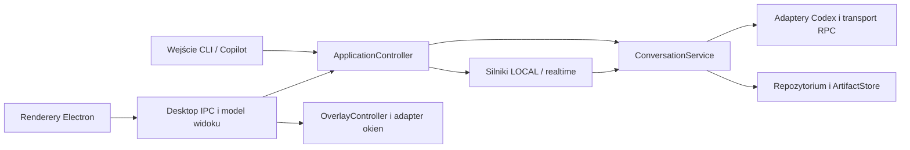

# Voice Line — przegląd przed dalszym rozwojem

Data: 10 października 2026. Zakres: kod aplikacji, konfiguracja, skrypty, testy oraz kontrakty z README.md, DESIGN.md i VERIFICATION-FLOWS.md. Przegląd obejmuje Electron, CLI, klawiaturę, nagrywanie, LOCAL/realtime, Codex, historię, obrazy i eksport. Początkowy przegląd nie zmieniał kodu produkcyjnego. Następnie wdrożono kolejno etapy 1–4 oraz uporządkowanie skryptów i testów. Sekcja „Realizacja refactoru” i końcowy audit opisują bieżący stan; od „Ocena” zachowano pierwotne ustalenia, reprodukcje i propozycje jako zapis przeglądu sprzed zmian. Wpisy „w toku” w dzienniku realizacji opisują stan w chwili danej części, nie pozostałe zadania.

## Realizacja refactoru

Etap 1 (F01–F10): wdrożony 10 października 2026. F02 było już wdrożone przed rozpoczęciem tej serii.

| ID | Wdrożenie |
| --- | --- |
| F01 | `CodexRpcTransport` przejmuje subprocess i RPC; obsługuje błędy wszystkich strumieni, odrzuca pending requests i zgłasza jedno rozłączenie. Test osobnego procesu potwierdza przeżycie asynchronicznego EPIPE. |
| F02 | Zachowane wcześniejsze recovery bieżącej/poprzedniej historii oraz kopie corrupt. |
| F03 | Produkcyjny `engine-supervisor.cjs`: starting/running/stopping/stopped, cleanup na close, pojedynczy restart, izolacja starych listenerów i kontrolowany błąd IPC. |
| F04 | Running/cancelling/finished/disconnected, ograniczone oczekiwanie na turn/completed po interrupt i odtworzenie połączenia przy nieznanym stanie. Kolejka obejmuje całą odpowiedź do zapisu sesji. |
| F05 | Nieczytelny indeks pobocznego trybu odracza cleanup; `cleanupHealth` raportuje plik i błąd. Żadne dane nie są wtedy usuwane; naprawa indeksu pozwala ponowić cleanup. Aktywny indeks nadal podlega ścisłej walidacji. |
| F06 | Whisper resetuje startup po stop/error/exit/close, ignoruje stare procesy i przerwany startup. Deadline inferencji zatrzymuje zawieszony serwer; kolejna transkrypcja uruchamia nowy. |
| F07 | Wspólny `writeAtomic` dla produkcyjnego eksportu rozmowy/PNG i testów: unikalny temp obok celu, write, rename, cleanup. Błąd write/rename zachowuje wcześniejszy eksport. |
| F08 | `ConversationRepository` zatwierdza historię i metadane przed publikacją pamięci. Dziennik w wersji 1 przy restarcie wycofuje zapis przerwany przed usunięciem dziennika. answered/reset/forget/restore zachowują pamięć po błędzie commit. |
| F09 | Wspólna geometria shell/przycisku dla CSS i natywnego trackera, niezależna od etykiety. Testy 64 × 80, brzegów oraz skali 100/125/150/200%. |
| F10 | Parser rozróżnia response/notification/server request. Request z kolidującym ID nie rozwiązuje requestu klienta. Approvals są odrzucane, pozostałe nieobsługiwane metody dostają jawny błąd RPC. |

Weryfikacja tej serii: `npm.cmd run check` — typecheck i 180/180 testów; `npm.cmd run test:integration` — speaker/storage/realtime PASS z symulowaną inferencją; `npm.cmd run test:desktop` — PASS na izolowanych danych. Natywny smoke wymagał uruchomienia poza sandboxem ze względu na zapis zrzutów. Nie wykonywano rzeczywistej inferencji ani cyklu mikrofonu.

Kontrakt F08 dotyczy jednego synchronicznego writera historii/metadanych. Punkt commit to usunięcie przygotowanego dziennika; dziennik pozostawiony po awarii jest wycofywany przed odczytem sesji. Indeks retencji jest zapisywany przed commit wymiany i może konserwatywnie zachować referencje z nieudanego zapisu; późniejszy cleanup obsługuje je według TTL. Wspólna transakcja indeksu, linków i blobów oraz migracja wersjonowanego formatu historii pozostają zakresem etapu 3. Atomowa podmiana i dziennik nie deklarują trwałości przy utracie zasilania (brak fsync).

Źródło kontraktu F10: [oficjalna dokumentacja app-server](https://learn.chatgpt.com/docs/app-server#message-schema), w tym approvals i żądania uprawnień. Obsługa interaktywnych pytań użytkownika oraz dynamic tools nie jest dodawana do aplikacji głosowej; otrzymują błąd nieobsługiwanej metody.

Etap 2: wdrożony. `ApplicationController` przejął sterowanie z entrypointu: startup, klawiaturę, nagrywanie, voice/text/reset/cancel/previous, maintenance i shutdown. Zależności engine/recorder/clock/event sink są wstrzykiwane. Kolejka czeka na zakończenie poprzedniego wywołania providera i sprzątnięcie WAV także po cancel; każda operacja ma ID i revision rozmowy, a stare callbacki są ignorowane. Snapshot składa osobno health usług, fazę odpowiedzi i dane operacji; tryb popupu pozostaje własnością OverlayController. `main.ts` obsługuje wyłącznie composition root, wejście klawiatury/IPC i sygnały procesu. Legacy `--debug-keys` deleguje do izolowanej diagnostyki klawiatury.

`conversation-contract.ts` definiuje neutralne ConversationClient/RealtimeConversationClient/Transcriber/SpeechPlayer, VoiceReply, ConversationExchange oraz referencje obrazów. `application-contract.ts` waliduje wejściowe komendy i definiuje typy zdarzeń/faz/health. Fabryka korzysta z jednego niemutowalnego `AppConfig`, przekazując snapshot do Codexa, Whisper, SAPI/Piper, recordera i FFplay. Legacy konstruktory korzystają z tych samych loaderów usług; nie odczytują ustawień przy kolejnych requestach. `CODEX_MODE` i `STT_MODE` z literówką zgłaszają błąd zamiast wybierać domyślny backend. Diagnostyka FFmpeg używa tego samego loadera executable. Wspólne formatowanie odpowiedzi i rozwiązywanie ścieżki danych znajdują się poza Electron, ze zgodnymi adapterami dawnych importów.

Weryfikacja etapu 2: `npm.cmd run check` — typecheck i 198/198 testów; testy publicznego API kontrolera voice/text/reset/cancel/previous/timeout/startup/shutdown/maintenance/tap/hold bez urządzeń oraz testy niezmienności konfiguracji. `npm.cmd run test:integration` i `npm.cmd run test:desktop` — PASS, z izolowanymi danymi i symulowaną inferencją. Regresje shutdown podczas przygotowywania storage app-server oraz podczas importu historii CLI potwierdzają brak późniejszego spawn.

Etap 3 w toku. `ArtifactStore` przejął zapis PNG i linków; zachowano zgodne adaptery dawnych importów. Mapowanie obrazu z protokołu jest czystą funkcją, poprawny blob nie jest nadpisywany przy odczycie, a uszkodzone bajty są zachowywane przed atomową podmianą. Kolejka wspólna dla katalogu danych chroni read-modify-write linków między instancjami; retry tego samego thread/turn zachowuje jeden link i pierwotny anchor. Wspólny neutralny writer atomowy obsługuje eksport, PNG, indeks i repozytorium.

Retencja współdzieli koordynator z ArtifactStore. Lease aktywnej rozmowy obejmuje pełną turę providera, zapis odpowiedzi oraz teardown realtime; CLI i zadania obrazów używają tej samej ochrony. Cleanup zdobywa claim przed zewnętrznym delete; touch usuwanego rekordu jest odrzucany, a revision pozwala pominąć inny rekord odnowiony podczas oczekiwania na delete. Wspólne PNG czekają na zwolnienie aktywnych operacji, zachowując tombstone do retry bez ponownego delete RPC. Kontrakt dotyczy jednego procesu writera; nie dodano blokad między procesami.

Weryfikacja tej części etapu 3: `npm.cmd run check` — typecheck i 205/205 testów PASS. Regresje obejmują równoległe linki, idempotencję, zachowanie mtime PNG, kopię corrupt, lease między instancjami retencji, touch podczas delete, odnowienie innego kandydata, referencję do usuwanego zadania, retry PNG oraz lease providera po commit i błędzie. `npm.cmd run test:integration` i `npm.cmd run test:desktop` — PASS z izolowanymi danymi i symulowaną inferencją.

Druga część etapu 3: `conversation-model.ts` zawiera czyste przejścia answer/reset/restore/forget/hydrate oraz regułę TTL. Fasada `ConversationSession` nie używa filesystemu i publikuje obliczony stan dopiero po commit. Repozytorium przejęło load historii/metadanych i quarantine uszkodzonej historii. Kopiowanie referencji obrazów chroni model przed mutacją wejściowego reply i snapshotu pobranego przez klienta.

`AppStorage.commitReply` serializuje pełny zapis z prune i ArtifactStore. Przygotowuje indeks i opcjonalny link, a repozytorium zatwierdza je razem z lokalną historią i metadanymi sesji. Dziennik w wersji 2 zawiera wcześniejsze bajty wszystkich plików oraz ścieżki ograniczone do root danych; recovery zachowuje obsługę dziennika w wersji 1. Usunięcie dziennika jest punktem commit; przerwanie wcześniej wycofuje wszystkie podmiany. Niepublikowane, zweryfikowane PNG mogą pozostać jako niepodlinkowane artefakty do retencji. Ten zapis zastępuje opisane wyżej ograniczenie F08 dotyczące indeksu zapisywanego przed commit wymiany. Nie deklaruje fsync ani obsługi wielu procesów writera.

Provider przechwytuje ID/revision sesji i sprawdza je przed zapisem. Commit w kolejce ponownie sprawdza revision oraz warunek anulowania tuż przed modyfikacją plików. Realtime po playback sprawdza także stan failed. Weryfikacja: `npm.cmd run check` — typecheck i 219/219 testów PASS, w tym błędy history/index/links/metadata, recovery po każdej z czterech podmian, zachowanie nowych/brakujących plików, niedozwolona ścieżka journal, produkcyjny commit linku, reset i cancel podczas oczekiwania na commit oraz niezależność modelu od mutacji referencji. Integracja speaker/storage/realtime — PASS na symulowanej inferencji.

Natywny `npm.cmd run test:desktop` po zmianie modelu i transakcji — PASS; obejmuje restart historii, previous/undo, obrazy i eksport na izolowanych danych. Nie wykonywano rzeczywistej inferencji ani cyklu mikrofonu.

Trzecia część etapu 3: produkcyjna fabryka storage zapisuje metadane i lokalną historię w wersji 2. Envelope historii zawiera ID rozmowy, revision oraz wymiany z trwałymi ID/revision. Metadane zachowują revision i receipts (hash treści zatwierdzonej wymiany), także dla realtime z historią odczytywaną z Codexa. Powtórzenie tego samego exchangeId nie odnawia TTL ani nie zmienia plików; ten sam ID z inną treścią jest odrzucany. Obsługiwane są również dwa równoległe retry i ponowienie po restarcie. Provider tekstowy wyznacza ID z tożsamości tury, CLI/audio z ID operacji, a linkowany obraz z tożsamości zadania. Legacy konstruktory bez fabryki zachowują dotychczasowy interfejs i format.

Migracja zapisuje wcześniej oryginalne bajty do unikalnego `.legacy-*`, a potem podmienia plik przez istniejący dziennik. Niepoprawne metadane są zachowywane jako `.corrupt-*`; nieznana wersja metadanych lub historii zgłasza błąd bez nadpisania tych danych. Błąd filesystemu podczas migracji pozostaje błędem storage i pozwala ponowić migrację po restarcie. Zwykły restart v2 nie tworzy dodatkowych kopii. Fixture `tests/helpers/storage-v1.ts` reprezentuje dawny format metadanych i dwóch historii, z obrazem oraz zadaniem ImageGen. Testy potwierdzają zachowanie bajtów, kolejności, ID, obrazów i undo. Realtime nadal identyfikuje odczytaną timeline niezależnie od runtime ID audio; ujednolicenie ich i filtrowanie anulowanych wymian pozostają poniżej.

Cleanup uwzględnia także niepodlinkowane PNG po nieudanej transakcji: pełny TTL mtime stanowi okno adopcji, wszystkie indeksy chronią referencje, aktywne lease blokują usuwanie, a kopie corrupt pozostają zachowane. Weryfikacja: `npm.cmd run check` — typecheck i 227/227 testów PASS. `npm.cmd run test:desktop` — PASS z izolowanymi danymi, w tym restart/undo i eksport; testy wire odczytują nowy envelope historii i tożsamość odpowiedzi.

`npm.cmd run test:integration` po aktualizacji asercji wire do formatu v2 — PASS (speaker/storage/realtime, symulowana inferencja).

Czwarta część etapu 3: `mapConversationTurns` i `mapRealtimeHistory` mapują protokół bez modyfikowania wejścia ani filesystemu. Dopiero jawna hydratacja wywołuje `ArtifactStore.ensure`; zgodne publiczne readery składają te dwie operacje. Regresja potwierdza brak plików po mapowaniu i powstanie PNG dopiero po hydratacji.

Realtime utrwala lokalną historię zatwierdzonych wymian w tej samej transakcji co receipts, indeks i metadane. Ten zapis jest źródłem historii wyświetlanej i kontekstu po restarcie, zachowuje runtime ID i nie przywraca transkryptów anulowanego requestu z timeline Codexa. Starsza rozmowa bez lokalnego pliku zachowuje referencję i importuje dostępny historyczny odczyt jeden raz; późniejsza timeline nie nadpisuje lokalnych commitów. Status anulowania bardzo starych wpisów bez identyfikatorów/statusów nie może być odtworzony z samych par transkryptów. Import jest chroniony lease i kolejką oraz zapisuje wszystkie referencje obrazów/zadań z historią i metadanymi. Retencja usuwa lokalne JSON także w realtime, po zapisaniu tombstone dla zewnętrznego delete. Przywrócenie poprzedniej rozmowy zatwierdza metadane i odnowienie indeksu razem; błąd indeksu zachowuje poprzedni stan.

`RealtimeCompletionBoundary` jawnie opisuje politykę adaptera v2: finalny transcript, 250 ms ciszy odnawianej przez każdą porcję audio, albo jawne response.done; potem drain i potwierdzenie stop przed commit. Audio po granicy podczas drain/stop zgłasza błąd i nie zatwierdza częściowej odpowiedzi. To kontrolowana polityka eksperymentalnego adaptera, nie dowód gwarancji maksymalnego opóźnienia prawdziwego backendu. Test wstrzykiwanego zegara oraz test providera obejmują opóźniony ogon po tej granicy. Błąd stop po playback również zachowuje historię bez nowej wymiany.

Weryfikacja tej części: `npm.cmd run check` — typecheck i 236/236 testów PASS. Regresje obejmują pure mapping, import wielu referencji, brak nadpisania przez remote timeline, stabilne ID po restarcie, abort przed commit, opóźnione audio, błąd stop oraz rollback restore przy błędnym indeksie. Integracja speaker/storage/realtime z symulowaną inferencją — PASS.

Natywny `npm.cmd run test:desktop` po zmianach import/restore — PASS na izolowanych danych. Powtórny wire realtime potwierdza również równość runtime exchangeId i ID historii po restarcie.

Etap 3 wdrożony. `ConversationId`, `CodexThreadId`, `TurnId` i `ImageId` mają odrębne typy i walidatory; nowe retained conversations otrzymują UUID aplikacji niezależny od UUID Codexa. Powiązanie jest utrwalone w metadanych oraz indeksie retencji, również dla wątku bez odpowiedzi. RPC/resume/CLI/delete używają ID providera, natomiast wybór rozmowy, pliki, undo i linki używają ID aplikacji. Dawne rekordy bez mapowania zachowują tożsamość identity-map. Pole `currentThreadId` oraz serializowane `ImageTask.threadId` pozostają zgodnymi nazwami API dla ID rozmowy aplikacji. Typy TurnId są używane przez aktywną turę, a ImageId przez zweryfikowany wynik mapowania PNG.

`ConversationService` przejął commitExchange/importHistory/restorePrevious/prune; AppStorage składa zależności i zachowuje delegujące adaptery API. Provider przekazuje wynik z ID operacji lub wykonuje wskazany delete zdalnego wątku. Usunięto przedwczesny zapis referencji obrazów CLI sprzed commit wymiany. README opisuje nowy zapis i odczyt realtime.

Audit warunków etapu 3: dziennik v1/v2 i regresje po każdej podmianie definiują recovery historii/metadanych/indeksu/linków; fault injection potwierdza rollback i brak publikacji pamięci; receipts oraz link identity zapewniają retry bez duplikatów także po restarcie; wspólne lease/claims i revision chronią aktywność przed cleanup; fixture v1 oraz testy current/previous/images/undo potwierdzają migrację z zachowaniem kopii; pure mapping i ArtifactStore rozdzielają odczyt protokołu od zapisu; tests audio/abort/drain/stop określają kontrolowaną politykę realtime. Test identyfikatorów sprawdza odrębność typów kompilatorem oraz różne UUID po reply/restart/resume/undo/CLI/delete i recovery indeksu dla wątku bez odpowiedzi. Kontrakt pozostaje single-writer, bez fsync i bez deklaracji gwarancji czasu nadejścia audio z eksperymentalnego backendu.

Końcowa bramka etapu 3: `npm.cmd run check` — typecheck i 240/240 testów PASS; `npm.cmd run test:integration` — speaker/storage/realtime PASS z symulowaną inferencją; `npm.cmd run test:desktop` — PASS na izolowanych danych po delegacji do ConversationService. Etap 4 pozostaje aktywnym zakresem celu: desktop composition root, wydzielony smoke, kontrakt/typecheck UI, przyrostowa historia, lazy images, limit kontekstu, pomiar skali i Windows CI.

Etap 4 w toku. Natywny smoke znajduje się w `tests/native/desktop-smoke.cjs`; produkcyjny entrypoint uruchamia go wyłącznie po `--smoke-test`, przekazując działające okna i adaptery. `desktop-ipc.cjs` rejestruje wejścia rendererów, walidację nadawcy, schowek, podgląd/zapis PNG oraz komendy workera. Gettery zachowują dostęp do bieżącego workera po restart i aktualnego stanu podczas shutdown; rejestracja ma jawne sprzątanie listenerów. Test schowka wykonuje ten moduł bez regexowego wycinania źródła. Pozostałe testy IPC sprawdzają granice tekstu, wymianę workera, retry przez supervisor, pomiary rozmiaru i disposal. Model widoku oraz adapter okien pozostają kolejnymi częściami etapu.

Weryfikacja tej części: `npm.cmd run check` — typecheck i 245/245 testów PASS; `npm.cmd run test:desktop` — PASS na izolowanych danych po przeniesieniu harnessu i IPC, w tym natywny hover, obrazy/eksport, restart/undo, pinning, composer i animacja wyjścia. Nie wykonywano rzeczywistej inferencji ani cyklu mikrofonu.

Druga część etapu 4: worker publikuje jawny `conversation` z ID/revision, zatwierdzonym `completed` i osobnym `pending` z ID/revision. Realtime zastępuje częściowy transkrypt w pending, nie wkłada go do historii. LOCAL przekazuje zatwierdzone wymiany przed playback; cancel playback zachowuje zapis, natomiast anulowany realtime usuwa pending. `desktop-conversation.cjs` jest modelem prezentacji: Electron nie dopisuje wymian na podstawie fazy ani nie utrzymuje archiwum undo. Eksport bierze zatwierdzone wymiany. Preview dostarcza jawne fixture, a syntetyczny worker natywnego smoke znajduje się wyłącznie w tests/helpers.

`desktop-contract.ts` definiuje komendy, rozłączne zdarzenia/żądania, API preload, model widoku i wyniki zapisu. `typecheck` obejmuje teraz również ścisłe JSDoc/checkJs preload i modelu prezentacji. Typowanie nie zastępuje walidacji runtime: ujednolicenie walidatorów granicy IPC/workera, rozszerzenie typowania rendererów, adapter okien, historia przyrostowa/lazy images, limit kontekstu, pomiary i CI pozostają w aktywnym zakresie etapu 4.

Weryfikacja drugiej części: `npm.cmd run check` — typecheck TS/checkJs i 250/250 testów PASS; regresje pending/commit/cancel/expiry sprawdzają publiczne API kontrolera i produkcyjny model prezentacji. `npm.cmd run test:integration` — speaker/storage/realtime PASS z symulowaną inferencją. `npm.cmd run test:desktop` — PASS po zmianie modelu i typowanego preload, z izolowanymi danymi; fixture smoke symuluje jawne snapshoty workera, a nie rzeczywisty cykl mikrofonu.

Trzecia część etapu 4: wspólny `desktop-validation.cjs` waliduje payloady rendererów i pełne zdarzenia workera. Kontroluje fazę/health/ready, ID/revision, pending, zatwierdzone wymiany, duplikaty ID i referencje PNG; kopiuje wyłącznie znane pola, odrzucając dodatkową historię/pola widoku. `desktop-worker.cjs` obsługuje zweryfikowane zdarzenia oraz poziom audio tylko dla aktualnej fazy. Natywny smoke wysyła symulowane zdarzenia voice przez ten produkcyjny receiver. Zdarzenia open/ready i odczyt/zapis obrazu respektują shutdown oraz zamknięte okno.

`desktop-windows.cjs` przejął tworzenie i zabezpieczenia okien, aktualną geometrię wskaźnika, rozmiary i animację popupu, opóźnione przywrócenie peek oraz listenery zmian monitorów. OverlayController nadal decyduje o widoczności/trybie/pinning. Dispose usuwa timery i własne listenery; shutdown podczas ładowania orba nie tworzy późnego panelu. Walidator, receiver, adapter i tracker wskaźnika są objęte checkJs. `orb-main.cjs` ma 294 wiersze zamiast początkowych 1045. Historia przyrostowa/lazy images, szerszy typecheck rendererów, limit kontekstu, pomiary oraz Windows CI pozostają aktywnym zakresem.

Weryfikacja trzeciej części: `npm.cmd run check` — typecheck TS/checkJs i 258/258 testów PASS; testy walidacji odrzucają błędne snapshoty i sprawdzają brak mutacji wejścia. Testy adaptera sprawdzają izolację okien, nawigację, aktualny hover po resize/zmianie monitora, disposal i shutdown podczas load. `npm.cmd run test:desktop` — PASS na izolowanych danych po zmianie adaptera i walidacji, wraz z eksportem/obrazami, restart/undo, composer, pinning i animacją wyjścia.

Czwarta część etapu 4: `history-renderer.js` używa ID/revision wymiany oraz revision rozmowy. Zachowuje istniejące węzły; append tworzy tylko nowe wpisy, a aktualizacja fazy bez zmiany historii pomija przebudowę i serializację treści. Prune, reorder, zmiana revision, reset i wybór innej rozmowy usuwają/aktualizują właściwe węzły. Nie utrzymuje DOM innych rozmów. Zgodny fallback dla fixture bez ID porównuje pola wymiany, bez stringify całej historii. Typecheck obejmuje teraz także conversation, history, answer, image renderer i cache.

Historyczne obrazy są pobierane dopiero blisko viewportu, bez odczytu ukrytej historii w peek; opuszczenie widoku usuwa `src` z base64, zachowując proporcje. Najnowszy obraz pozostaje eager. `image-preview-cache.js` deduplikuje równoczesny odczyt i stosuje LRU: maksymalnie 24 wpisy i 16 MiB liczonego zachowawczo rozmiaru stringów. Większy obraz nie jest cache'owany. Błąd odczytu nie zatruwa retry, a błąd dekodowania usuwa wpis cache. Limity cache nie są deklaracją limitu całej pamięci Chromium ani liczby DOM bieżącej rozmowy.

Pomiar `tests/native/history-scale.cjs` wykonuje dawny algorytm zachowany z conversation.js w `tests/helpers/history-baseline.js` oraz produkcyjny renderer w tym samym Electronie, dla 100/1000/3000 wymian z blokiem kodu. Mierzy synchroniczne operacje DOM: pierwszy render, 20 aktualizacji fazy oraz 3 dopisania. Nie obejmuje IPC, layout/paint, filesystemu, eksportu ani audio; czasy są obserwacjami, nie progami bramki. Pierwszy render nadal ma koszt liniowy.

| Wymiany | Pierwszy render dawny/nowy (ms) | 20 faz dawny/nowy (ms) | 3 dopisania dawny/nowy (ms) |
| --- | --- | --- | --- |
| 100 | 4,8 / 1,5 | 3,2 / poniżej rozdzielczości zegara | 7,4 / 0,8 |
| 1000 | 16,2 / 16,5 | 13,9 / 0,1 | 62,3 / 0,9 |
| 3000 | 46,2 / 42,8 | 51,3 / poniżej rozdzielczości zegara | 158,4 / 2,3 |

Artefakt tego pomiaru: [.chatgpt-button/test-results/desktop-ncqWnl/history-scale.json](.chatgpt-button/test-results/desktop-ncqWnl/history-scale.json), Electron 44.5.1 / Chromium 152.0.7977.130. Smoke potwierdza zachowanie pierwszego węzła, fokusu i stanu kopiowania, tylko 3 nowe wpisy po 3 dopisaniach, aktualizację revision, prune/reorder/switch/reset, brak odczytu cache/PNG w ukrytej historii, wczytanie widocznego obrazu i zwolnienie offscreen src. `npm.cmd run check` — TS/checkJs i 261/261 testów PASS; `npm.cmd run test:desktop` — PASS z pomiarem i dotychczasowymi scenariuszami. Limit i skracanie kontekstu oraz Windows CI pozostają aktywnym zakresem etapu 4.

Piąta część etapu 4: `conversation-context.ts` jest wspólnym builderem kontekstu LOCAL ephemeral i audio realtime. Polityka wybiera chronologiczny suffix maksymalnie 32 wymian i 32 KiB UTF-8 JSON, uwzględniając escape i role. Starsze pary są pomijane w całości; jeśli ostatnia para sama nie mieści się w budżecie, jej pytanie/odpowiedź zachowują początek i koniec, bez rozcinania emoji, z markerem skrócenia. Prompt informuje o pominięciu. Bieżące pytanie i instrukcje pozostają poza budżetem historii; nie jest to estymator tokenów. Builder nie modyfikuje historii, plików ani undo. Test durable storage potwierdza komplet 40 wymian po reset/restart/restore pomimo ograniczonego promptu, a test providera realtime sprawdza rzeczywiste params start z 60 zapisanych wymian.

`.github/workflows/check.yml` konfiguruje Windows CI na push/pull_request/manual dispatch: Node 22.18.0, npm ci z lockfile i npm run check, uprawnienie contents:read, bez persist-credentials i z wyłączonym pobieraniem runtime Electron. Job nie uruchamia urządzeń, klawiatury, desktopu, integracji ani inferencji. Użycie v7 i wejść odpowiada [oficjalnemu checkout](https://github.com/actions/checkout) oraz [setup-node](https://github.com/actions/setup-node). Workflow sprawdzono actionlint 1.7.12 z oficjalnego release, po porównaniu SHA-256 archiwum. Świeża izolowana kopia Windows z Node 22.18.0 przeszła npm ci i 270/270 testów check; [log check](.chatgpt-button/test-results/ci-2ccc11b17b17417dabdba98b43a4775d/check.log) i [log instalacji](.chatgpt-button/test-results/ci-2ccc11b17b17417dabdba98b43a4775d/npm-ci.log) pozostają w artefaktach. Tymczasową kopię i jej node_modules usunięto. Repo nie ma remote, więc nie wywołano i nie deklaruje się udanego joba na GitHubie.

Końcowa bramka implementacji etapu 4: `npm.cmd run check` — TS/checkJs i 271/271 testów PASS; `npm.cmd run test:integration` — speaker/storage/realtime PASS z symulowaną inferencją; `npm.cmd run test:desktop` — PASS z dotychczasowymi scenariuszami i pomiarem skali po ostatnich zmianach UI/buildera, artefakty w `.chatgpt-button/test-results/desktop-eLnCpi`. Fizyczny mikrofon, jakość STT/TTS, rzeczywista inferencja realtime i zdalny job GitHub nie zostały potwierdzone przez powyższe symulowane bramki.

### Końcowy audit wymagań

Audit bieżącego drzewa z 10 października 2026: zakres implementacyjny etapów 1–4 zakończony. Poniższa mapa wiąże warunki zakończenia z produkcyjnymi granicami i regresjami; wcześniejsze liczby testów są historycznymi bramkami kolejnych części.

| Warunek raportu | Implementacja i dowód |
| --- | --- |
| F01/F10: pipe error nie kończy workera; trzy rodzaje wiadomości RPC | `src/codex-rpc-transport.ts`; `test-codex-transport.ts`: osobny proces z rzeczywistym asynchronicznym Writable EPIPE, błędy wszystkich strumieni, stop, kolidujące ID i odpowiedzi na server request. |
| F02/F05: uszkodzona poprzednia historia i indeks pobocznego trybu nie blokują sprawnego trybu | `conversation-repository.ts`, `conversation-retention.ts`; `test-app-storage.ts` i `test-retention-recovery.ts`: quarantine oryginalnych bajtów, nowa odpowiedź, cleanup odroczony bez delete i retry po naprawie. |
| F03/F06: retry i start–stop–start | `electron/engine-supervisor.cjs`, `src/stt/transcriber.ts`; `test-engine-supervisor.cjs`: nieudany real spawn, dwa retry, stare listenery, IPC i shutdown; `test-whisper-lifecycle.ts`: restart, deadline i stop podczas startup. |
| F04/F08: pełna operacja do commit; pamięć dopiero po trwałym zapisie | `codex-app-server.ts`, `conversation-service.ts`, `conversation-session.ts`; `test-codex-turn-lifecycle.ts`: brak/późne interrupt completion; `test-session-commit.ts`: EACCES/ENOSPC, odrzucone przejścia i recovery między każdą podmianą. |
| F07: wcześniejszy eksport przeżywa błąd | `src/atomic-file.cjs` oraz produkcyjny adapter eksportu; `test-atomic-file.cjs`: częściowy write ENOSPC, rename EACCES, cleanup temp i równoległe zapisy; native smoke wykonuje `saveCurrentConversation` i IPC zapisu PNG. |
| F09: aktualna geometria hover | `orb-geometry.cjs`, `overlay-pointer.cjs`, `desktop-windows.cjs`; `test-orb-geometry.cjs` i `test-desktop-windows.cjs`: brzegi, skale, resize i zmiana monitora; native smoke przechodzi kolejne pytania i resize bez fałszywego wyjścia. |
| Publiczne voice/text/reset/cancel/previous/timeout; jedna aktywna operacja i shutdown | `application-controller.ts` z wstrzykiwanymi usługami/zegarem; `test-application-controller.ts`: publiczne komendy bez urządzeń, oczekiwanie na poprzednie wywołanie, ignorowanie późnych callbacków, sprzątanie WAV, startup/shutdown i maintenance. `src/main.ts` pozostaje entrypointem. |
| Neutralne kontrakty, jedna konfiguracja i rozdzieleni właściciele stanu | `conversation-contract.ts`, `application-contract.ts`, `app-config.ts`, `desktop-contract.ts`; `test-app-config.ts` sprawdza walidację i snapshot. Controller jest właścicielem operacji/health, model sesji historii/undo, OverlayController widoczności/trybu/pinning. |
| Crash recovery, brak duplikatów exchange/link, ochrona aktywności | Repozytorium v2 i wspólny `storage-coordinator.ts`; `test-session-commit.ts`, `test-storage-migration.ts`, `test-storage-coordination.ts`: rollback wszystkich plików, retry po restarcie, równoległe linki, lease/claim i retry tombstone bez drugiego remote delete. |
| Migracja zachowuje historię, obrazy i undo; ID aplikacji niezależne od providera | `conversation-format.ts`, `conversation-identifiers.ts`, fixture `tests/helpers/storage-v1.ts`; `test-storage-migration.ts` i `test-conversation-identifiers.ts`: kopie legacy, trwałe ID/revision, kolejność i undo po restarcie, mapowanie RPC/delete na ID Codexa. |
| Mapowanie protokołu bez zapisu; poprawne PNG ponownie używane | `conversation-history.ts`, `artifact-store.ts`; `test-images.ts` oraz `test-storage-coordination.ts`: jawna hydratacja, brak plików po mapowaniu, zachowany mtime blobu i kopia corrupt. |
| Realtime: jawny koniec audio i brak przywrócenia anulowanej wymiany | `realtime-completion.ts` i lokalne commity providera; `test-realtime-completion.ts`, `test-realtime.ts`: opóźniony ogon, błąd stop, oczekiwanie na teardown, restart po abort oraz jednorazowy import legacy. |
| Desktop podzielony; completed/pending od workera; produkcyjne IPC i harness | `desktop-worker.cjs`, `desktop-conversation.cjs`, `desktop-ipc.cjs`, `desktop-windows.cjs`; testy odpowiadających modułów, `test-clipboard.cjs` i `tests/native/desktop-smoke.cjs`. Electron nie utrzymuje domenowego archiwum undo; eksport korzysta z completed. |
| Sprawdzalny kontrakt IPC i typecheck UI | Runtime `desktop-validation.cjs` odrzuca niepoprawne payloady; `tsconfig.desktop.json` obejmuje preload, model, receiver, adapter, tracker oraz renderery conversation/history/answer/image/cache. Gradual checkJs pozostawia pozostałe UI w dotychczasowym języku zgodnie z zakresem raportu. |
| Historia przyrostowa, lazy images, bounded cache i pomiar długiej rozmowy | `history-renderer.js`, `image-renderer.js`, `image-preview-cache.js`; unit cache oraz [aktualny pomiar i asercje Chromium](.chatgpt-button/test-results/desktop-eLnCpi/history-scale.json): 100/1000/3000 wymian, zachowany DOM/fokus, append/revision/prune/reorder/switch/reset, brak odczytu ukrytych PNG i zwolnienie offscreen src. |
| Testowana polityka kontekstu bez utraty historii/undo | `conversation-context.ts`, `test-conversation-context.ts` i rzeczywiste params start w `test-realtime.ts`: budżet JSON, chronologiczny suffix, skracanie Unicode i pełna historia po reset/restart/restore. |
| Zachowane fundamenty i scenariusze VERIFICATION-FLOWS | Zachowano LOCAL/realtime, OverlayController i CopilotGesture. `test-overlay.cjs`, testy gesture/controller i native smoke pokrywają wskazaną w tabelach część automatyczną V/I/E/A/H: widoczność/timery, composer/IME/szkic, fokus/pinning, scroll, reduced motion, restart/undo, obrazy/eksport i exit. CSP, sandbox, context isolation, brak Node i blokady nawigacji pozostają w produkcyjnych oknach; adapter ma regresje tych ustawień. Kolumny kontroli ręcznej nadal oznaczają kontrole ręczne, nie wykonane testy urządzeń. |
| Bezpieczny zestaw check i Windows CI | Publiczne polecenia i izolowany runner zachowane; workflow `.github/workflows/check.yml` sprawdzony actionlint i świeżą lokalną instalacją Windows. Na tym lokalnym etapie brak remote uniemożliwiał potwierdzenie wykonania joba GitHub. Aktualizacja 2026-11-09: po wypchnięciu zmian Windows CI przeszedł na Node 22.18.0 i 26.x, a PR #1 został scalony; zob. [raport gotowości](docs/READINESS.md). |

Nie wprowadzano warunkowych propozycji przyszłego rozwoju: SQLite/multi-process writer, protokół artefaktów zamiast base64 ani usunięcie dziedziczenia realtime po delegacji. Raport wskazuje je jako późniejszy kierunek, a nie warunek czterech etapów. Gwarancje storage dotyczą jednego procesu writera i recovery awarii procesu; brak fsync pozostaje opisanym ograniczeniem. Ręczne kontrole urządzeń/usług z VERIFICATION-FLOWS pozostają osobnym sprawdzeniem środowiska.

## Ocena

Aplikacja ma sensowne fundamenty i nadaje się do stopniowego refactoru. Największy koszt kolejnych funkcji wynika z rozproszonej odpowiedzialności za cykl życia operacji i zapis rozmowy. Ta sama czynność przechodzi przez worker, provider, sesję, retencję, Electron main i renderer, a każdy z tych elementów utrzymuje część własnego stanu.

Najpierw warto poprawić odporność na awarie i utrwalić kontrakty. Sam podział dużych plików nie usunie znalezionych problemów. Nie widzę w tym przeglądzie uzasadnienia dla zmiany frameworka UI, przepisywania aplikacji ani natychmiastowej migracji historii do bazy danych.

## Najważniejsze ustalenia

P1 oznacza awarię procesu lub zablokowanie podstawowej funkcji, którą warto naprawić przed kolejną większą funkcją. P2 oznacza błąd warunkowy albo istotną lukę odporności. Podatności na współbieżność, których osiągalności w normalnym UI nie wykazano, są opisane osobno.

| ID | Priorytet | Ustalenie | Miejsce |
| --- | --- | --- | --- |
| F01 | P1 | Błąd pipe Codexa może zakończyć worker | src/codex-app-server.ts:184 |
| F02 | P1 | Uszkodzona poprzednia historia może zablokować start | src/conversation-session.ts:47 |
| F03 | P2 | Retry nie działa po nieudanym spawn silnika | electron/orb-main.cjs:117, :283 |
| F04 | P2 | Timeout tury pozostawia nieustalony stan operacji | src/codex-app-server.ts:283, :319 |
| F05 | P2 | Uszkodzony indeks innego trybu blokuje sprawny tryb | src/conversation-retention.ts:57 |
| F06 | P2 | Whisper nie resetuje stanu startup po stop/awarii | src/stt/transcriber.ts:44, :91 |
| F07 | P2 | Eksport może zniszczyć wcześniejszy plik przy błędzie zapisu | electron/orb-main.cjs:88 |
| F08 | P2 | Nieudany zapis sesji pozostawia zmieniony stan w pamięci | src/conversation-session.ts:105 |
| F09 | P2 | Natywny hover kulki jest przesunięty o 8 px | electron/overlay-pointer.cjs:8 |
| F10 | P2 | Parser RPC myli request serwera z odpowiedzią | src/codex-app-server.ts:208 |

### F01 — obsłużyć awarię strumienia, zanim zakończy worker

`send()` sprawdza proces i `stdin.destroyed`, po czym wywołuje `stdin.write()` bez obsługi asynchronicznego błędu strumienia. Listenery `child.error` i `child.close` nie przejmują zdarzenia `stdin.error`. Jeżeli app-server zamknie pipe między sprawdzeniem a zapisem, Node może zakończyć worker przez nieobsłużone `EPIPE`.

Dowód: harness offline podstawił `Writable` zwracający asynchroniczne `EPIPE`; proces zakończył się kodem 1 i komunikatem `Unhandled 'error' event`. Nie uruchamiano rzeczywistego Codexa w tej reprodukcji.

Zmiana: wydzielić transport JSON-RPC, który obsługuje błędy wszystkich strumieni, odrzuca oczekujące requesty i emituje jedno zdarzenie rozłączenia. Test regresji: awaria podczas write, podczas oczekiwania na odpowiedź i podczas zamykania; worker pozostaje zdolny opublikować kontrolowany błąd.

### F02 — uszkodzenie jednej rozmowy nie powinno blokować całej aplikacji

Konstruktor `ConversationSession` obsługuje błędy metadanych, ale późniejsze wczytanie bieżącego i poprzedniego `<id>.json` odbywa się poza tym recovery. `readLocalHistory()` przekazuje błędy JSON i walidacji dalej. Uszkodzona poprzednia rozmowa blokuje `createAppStorage()` nawet wtedy, gdy użytkownik chce rozpocząć nową.

Dowód: w świeżym katalogu tymczasowym utworzono metadane poprzedniej rozmowy i niepoprawny JSON jej historii; konstrukcja storage rzuciła wyjątek. Istniejący test uszkodzonych metadanych nie obejmuje tego przypadku.

Zmiana: jawne ładowanie po konstrukcji i wynik `loaded/missing/corrupt`; odizolować uszkodzoną rozmowę i zachować jej plik do odzyskania. Nie zastępować błędnego pliku pustą historią bez śladu. Testy: bieżąca/poprzednia historia, błędny JSON, `[null]`, niepoprawne referencje obrazów i historia starsza niż retencja.

Status F02: wdrożone. `createAppStorage()` jawnie wywołuje `loadLocalHistory()` po konstrukcji sesji i udostępnia `historyLoadResults` (`loaded/missing/corrupt`). Walidacja obejmuje wymiany, referencje obrazów i identyfikatory zadań ImageGen. Uszkodzony plik zostaje przeniesiony do `<id>.json.corrupt-<uuid>` w tym samym katalogu; recovery aktualizuje wyłącznie metadane i odłącza wadliwą rozmowę, zachowując sprawną. Brakująca lub pusta historia również nie pozostawia aktywnej referencji. Retencja nie usuwa zachowanej kopii JSON; PNG nadal podlegają dotychczasowej retencji. Błędy dostępu do filesystemu i zapisu metadanych pozostają błędami storage, nie są klasyfikowane jako uszkodzenie JSON. Weryfikacja: `npm.cmd run check` PASS, typecheck i 138/138 testów, w tym regresje obu trybów lokalnej historii, restartu, nowej odpowiedzi oraz cleanup historii starszej niż retencja.

### F03 — supervisor procesu powinien obsłużyć również nieudany spawn

Electron zapisuje `engine = child`. Handler `error` pozostawia tę referencję, a sprzątanie następuje tylko na `exit`. Retry wysyła do starego obiektu `shutdown` i oczekuje na jego `exit`. Przy `ENOENT` nie ma uruchomionego procesu, a zdarzenie `exit` może w ogóle nie wystąpić; `close` występuje po błędzie spawn. Potwierdza to [kontrakt ChildProcess w Node.js](https://nodejs.org/api/child_process.html#event-close).

Dowód: reprodukcja na nieistniejącym executable dała `error/close`, bez `exit`; późniejsze `send` zgłosiło `ERR_IPC_CHANNEL_CLOSED`.

Zmiana: jeden supervisor z `starting/running/stopping/stopped`, sprzątaniem na `close`, sprawdzaniem IPC i pojedynczym restartem. Listenery starego procesu powinny być odrzucane według tożsamości instancji. Testy: brak binary, rozłączenie IPC, śmierć procesu i dwa szybkie retry.

### F04 — odrzucenie Promise nie oznacza zakończenia tury na serwerze

Watchdog 300 s wysyła interrupt i odrzuca lokalne `completion`. `finally` czyści `this.turn` tylko wtedy, gdy nie otrzymano ID tury. Następne wywołanie ignoruje odrzucenie wcześniejszego `completion` i może rozpocząć kolejną turę przed potwierdzeniem zakończenia starej.

Dowód: w harnessie skrócono wyłącznie watchdog do 20 ms. Po timeout pozostał `turn_1`, a drugie `respond()` wysłało `turn/start` dla `turn_2` bez wcześniejszego `turn/completed` pierwszej tury. Reakcja prawdziwego backendu zależy od jego stanu; nie potwierdzono, że zawsze zaakceptuje oba wywołania.

Zmiana: jawne `running/cancelling/finished/disconnected` i ograniczony czas oczekiwania na zakończenie interrupt. Gdy stan zewnętrznej operacji pozostaje nieznany, odzyskać połączenie przed kolejną turą. Testy: brak odpowiedzi na interrupt, późne `turn/completed`, kolejna prośba po deadline i reset w tym oknie.

### F05 — maintenance ma za duży wpływ na dostępność odpowiedzi

Retencja czyta indeksy LOCAL, realtime i ImageGen podczas sprawdzania referencji. Błędny indeks nieużywanego trybu powoduje wyjątek. Cleanup jest wymagany na startup i przed turą w `CodexAppServer`, więc uszkodzone dane poboczne blokują sprawne pytania.

Dowód: uszkodzony `imagegen-codex/history-index.json` zablokował prune LOCAL w osobnym katalogu testowym.

Zmiana: osobno raportować kondycję storage i cleanup. Przy nieczytelnym indeksie wstrzymać usuwanie współdzielonych obrazów i umożliwić działanie sprawnej rozmowy. Nie traktować uszkodzonego indeksu jako pustego. Odczyt aktywnej historii nadal wymaga jawnego recovery. Testy: błąd innego trybu, późniejsza naprawa indeksu i retry cleanup.

### F06 — startup Whisper nie jest stanem zdrowia procesu

`startPromise` jest cache'owany. `stop()` nie usuwa go, a handler wyjścia ustawia tylko lokalne `failed`. Po udanym starcie i awarii następne `transcribe()` korzysta z rozwiązanego Promise i odpytuje martwy serwer. Po odrzuconym startup następne `start()` zwraca to samo odrzucenie.

Dowód: mock `startServer`; sekwencja `start → stop → start` wykonała jeden start, pozostawiając `server === null`.

Zmiana: supervisor Whisper resetujący stan na `error/close/stop`, z kontrolowanym restartem i deadline inference. Testy lifecycle z podstawionym launcherem i HTTP; nie wymagają mikrofonu ani modelu Whisper.

### F07 — zapis eksportu powinien zachować poprzedni plik przy błędzie

Produkcyjne `saveCurrentConversation()` zapisuje bezpośrednio do wybranej ścieżki przez `fs.writeFile`. `ENOSPC`, przerwany zapis lub zakończenie procesu po otwarciu celu może pozostawić częściowy eksport zamiast istniejącego pliku.

Dowód: fault injection błędu po częściowym zapisie w helperze o tym samym wzorcu zapisu wykazał utratę wcześniejszej zawartości. Dodatkowa luka testów: `scripts/test-app-storage.ts:193` sprawdza `saveConversation()` z `conversation-export.cjs`, podczas gdy Electron używa własnego zapisu w `orb-main.cjs:88`.

Zmiana: jeden writer używany przez testy i produkcję; unikalny temp w katalogu docelowym, pełny zapis, następnie zastąpienie celu. Atomowa podmiana pliku nie zastępuje osobnego kontraktu trwałości przy awarii systemu. Testy: błąd write/rename, zachowanie poprzedniego pliku i sprzątanie temp. Ten sam wzorzec warto stosować do zapisu pojedynczego obrazu.

### F08 — pamięć i dysk mają różne zasady zatwierdzania przejść

`answered()` dodaje exchange i odnawia TTL przed `persist()`. Jeżeli zapis historii lub metadanych zawiedzie, operacja zgłasza błąd, ale pamięć zawiera już nową odpowiedź. `reset()` i `forget()` również najpierw zmieniają pamięć; `restorePrevious()` zapisuje przed zmianą stanu. Dodatkowo historia i metadane są podmieniane jako dwa osobne pliki.

Dowód: kolejność instrukcji w `conversation-session.ts:103`, `:129`, `:143`; brak rollback po błędzie. To ustalenie z inspekcji kodu, a nie test odłączenia dysku.

Zmiana: obliczyć następny snapshot, zatwierdzić go w repozytorium i dopiero opublikować. Zdefiniować recovery dla przerwania między zapisem historii, metadanych i indeksu retencji. Testy: `EACCES/ENOSPC`, stan po odrzuconym commit i restart między poszczególnymi zapisami.

### F09 — geometria okna i geometria hit targetu rozjechały się

Shell ma 64 × 80 px po dodaniu etykiety LOCAL/API. Przycisk kulki nadal ma 54 × 54 px na `(5,5)`, ze środkiem `(32,32)`. Natywny tracker używa połowy wysokości całego okna, czyli środka `(32,40)`.

Dowód: dla okna na `(0,0)` punkt `(32,8)` jest wewnątrz przycisku, lecz tracker nie zgłasza hover; `(32,64)` leży pod przyciskiem, lecz tracker zgłasza hover. Test trackera w `scripts/test-overlay.cjs:122` nadal używa okna o wysokości 64 px.

Zmiana: wspólny kontrakt rzeczywistej geometrii interakcji, niezależny od shell i miejsca na etykietę. Testy aktualnych 64 × 80 px, punktów brzegowych i skalowania DPI.

### F10 — transport potrzebuje trzech rodzajów wiadomości RPC

Parser uznaje każdą wiadomość z liczbowym `id` za odpowiedź. Request serwer → klient ma również `id`, ale zawiera `method`. Przy kolizji ID może rozwiązać niewłaściwy pending request wartością `undefined`; bez kolizji zostaje zignorowany. Dwukierunkowy protokół i requesty serwera są opisane w [oficjalnej dokumentacji app-server](https://learn.chatgpt.com/docs/app-server#approvals).

Dowód: oczekujący `thread/read` z ID 1 oraz dostarczony request `item/tool/requestUserInput` z ID 1 rozwiązały pierwszy Promise wartością `undefined`. Nie wykazano, że normalne pytania tekstowe w obecnej konfiguracji wywołują taki request.

Zmiana: rozróżniać response, notification i server request według envelope, obsługiwać obsługiwane metody i jawnie odpowiadać odmową/błędem na pozostałe zgodnie z kontraktem. Testy kolizji ID, requestów bez kolizji i nieznanych metod.

## Ryzyka współbieżności i eksperymentalnego realtime

Te punkty wymagają utrwalenia invariantów modułów. Nie są deklaracją, że każdy z tych scenariuszy jest obecnie osiągalny przez zwykłe użycie UI.

| Obszar | Dowód / ograniczenie | Kierunek |
| --- | --- | --- |
| Linki obrazów | `image-artifacts.ts:22`: dwa równoległe appendy w temp dały jeden sukces, jeden błąd i jeden link; read-modify-write i wspólne `.tmp` | Kolejka zapisów per conversation oraz idempotencja; samo unikalne `.tmp` nie usuwa lost update |
| Retencja a aktywność | `conversation-retention.ts:62`: `touch()` podczas await delete zostało później oznaczone jako deleted i usunięte; guard chroni tylko równoległe prune tej instancji | Wspólny lock/lease przed rozpoczęciem usuwania i kontrola wersji wpisu; ponowne sprawdzenie po usunięciu jest za późne |
| Pełna operacja odpowiedzi | `codex-app-server.ts:230` usuwa aktywną turę przed await zapisu obrazów i commit sesji w `:308`; `runTurn` serializuje tylko completion | Serializować całą operację do commit/rollback, przechwytywać conversation ID i revision; `main.ts` obecnie ogranicza zwykłe nakładanie pytań |
| Koniec audio realtime | `codex-realtime.ts:231` używa 250 ms ciszy po finalnym transkrypcie; brak testu porcji audio po tym oknie | Jawna polityka zakończenia w adapterze wersji, test opóźnionego ogona; nie potwierdzono naruszenia gwarancji eksperymentalnego API |
| Historia anulowanego realtime | Runtime zatwierdza wymianę po playback, lecz odtwarzanie timeline bierze realtime transcript segments | Ustalić status completed/cancelled w historii i sprawdzić restart po abort; zachowania rzeczywistej zapisanej timeline przy abort nie zweryfikowano |

## Granice architektury, które warto poprawić

### 1. Oddzielić sterowanie aplikacją od entrypointów

`src/main.ts` łączy konstruowanie usług, klawiaturę, stan operacji, nagrywanie, timer retencji, publikowanie IPC i shutdown. Jest krótszy od Electron main, ale trudno testować go bez uruchomienia całego procesu, ponieważ inicjalizuje zasoby na poziomie modułu.

Wydzielić `ApplicationController` z wstrzykiwanymi silnikiem, recorderem, clock i event sink. Entry pointy desktop/CLI powinny tylko załadować konfigurację, podłączyć wejścia i wystartować kontroler. Zachować sprawdzanie generation/AbortSignal, ale nadać operacjom jawne ID i revision rozmowy.

Stan zdrowia usług, faza odpowiedzi oraz tryb popupu to różne pojęcia. Powinny mieć osobnych właścicieli i być składane w snapshot, zamiast jednego `state: string` plus luźnych flag.

### 2. Rozdzielić transport, provider i zarządzanie rozmową

`CodexAppServer` jest jednocześnie transportem subprocess/RPC, konfiguracją konta, klientem tur, hydracją historii, retencją i writerem obrazów. `CodexRealtime` dziedziczy ten zestaw i dokłada drugi lifecycle oraz osobny image worker. Utrudnia to zarówno recovery, jak i testowanie.

Proponowane odpowiedzialności: `JsonRpcTransport`, adapter tekstu/realtime, `ConversationService` oraz `ArtifactStore`. Serwis rozmowy powinien przejąć commit/restore/retencję, a provider dostarczać wynik z metadanymi operacji. Najpierw można wydzielić transport przez delegację i zachować dotychczasowy publiczny interfejs; dopiero później usuwać dziedziczenie realtime.

Kontrakty `ConversationClient` i `VoiceReply` powinny należeć do neutralnej warstwy domeny. Obecne `Pick<CodexClient, ...>` w `voice-engine.ts:5` wyprowadza abstrakcję z konkretnego backendu. `Transcriber` i `SpeechPlayer` również warto opisać własnymi interfejsami.

### 3. Jeden właściciel trwałego zapisu

`ConversationSession` łączy model sesji, zegar, undo, budowanie promptu i filesystem. Historię, metadane, indeks retencji, image links i PNG zapisują różne moduły. Poszczególne pliki mają częściowo atomowy zapis, ale nie ma wspólnego kontraktu dla całej wymiany.

Wydzielić czysty stan sesji oraz `ConversationRepository` z `load/commitExchange/restore/delete`. Dodać wersję formatu, walidację zewnętrznych danych i procedurę recovery. Odseparować `ConversationId` aplikacji od `CodexThreadId`, `TurnId` i `ImageId`.

`readConversationHistory()` także zapisuje artefakty; oddzielić mapowanie odpowiedzi protokołu od `ArtifactStore.ensure()`. Store powinien ponownie używać poprawnego blobu pod jego hashem, zamiast nadpisywać go przy każdym odczycie.

JSON nadal może wystarczyć przy jednym writerze. SQLite stanie się uzasadnione, gdy potrzebne będą transakcje wielu rekordów, wyszukiwanie, duże historie lub wielu writerów. Najpierw wprowadzić repozytorium, aby późniejsza migracja nie dotknęła UI i providerów.

### 4. Electron main jako composition root i adapter platformy

`electron/orb-main.cjs` ma 1045 linii, z czego 563 stanowi wbudowana funkcja `verify()`. Pozostała część nadal łączy widok rozmowy, proces backendu, IPC, eksport, tray, geometrię i shutdown.

Rozdzielić supervisor procesu, redukcję snapshotów rozmowy, rejestrację IPC i adapter okien. Zachować `overlay-controller.cjs` jako właściciela widoczności, trybu i pinning. Wyprowadzić natywny smoke do osobnego harnessu uruchamiającego te same moduły co produkcja.

`sendVoice()` odtwarza historię na podstawie częściowych aktualizacji oraz utrzymuje kopie poprzednich rozmów. Worker powinien publikować jednoznaczne completed/pending exchanges z revision; Electron potrzebuje modelu prezentacji i cache, a nie kolejnych reguł domeny.

### 5. Sprawdzalny kontrakt między procesami i jeden loader konfiguracji

`tsconfig.json` obejmuje tylko TS w src i scripts. Electron i preview pozostają poza typecheck. Lista aktywnych stanów, komendy i kształt snapshotów są powielone w main, rendererze, kontrolerze i IPC. Preload wystawia `command(string)`.

Wspólny `desktop-contract` powinien definiować rozłączne typy komend/zdarzeń, API preload i wynik operacji. Typy nie zastępują walidacji payloadu na granicy IPC. Dodać stopniowo JSDoc/checkJs albo TS dla nowych wydzielanych modułów; bez obowiązku jednorazowej migracji całego UI.

`process.env` jest czytane w wielu konstruktorach i metodach, część wartości jest cache'owana, a część odczytywana przy każdym żądaniu. Wczytać i zwalidować jeden niemutowalny `AppConfig`, przekazywany do fabryk. `CODEX_MODE`/`STT_MODE` z literówką obecnie wpadają w domyślny backend. Diagnostyka konfiguracji powinna identyfikować konkretną usługę.

Neutralne formatowanie odpowiedzi i wyznaczanie ścieżek danych przenieść poza Electron: dziś backend importuje `electron/answer-format.js`, a `app-storage.ts` wymaga `electron/app-data.cjs`.

### 6. Koszt dłuższych rozmów kontrolować przed rozbudową historii

Renderer serializuje całą historię przy każdej migawce i po zmianie odtwarza wszystkie historyczne elementy. Każdy historyczny obraz ponownie pobiera pełny PNG przez base64 IPC, także przy ukrytej historii w peek. Nie wykonano pomiaru spadku wydajności, więc to ryzyko skali, nie potwierdzona regresja.

Wprowadzić stabilne ID/revision wymian, renderowanie przyrostowe i ładowanie obrazów na żądanie z ograniczonym cache. Bezpieczny protokół artefaktów może docelowo zastąpić duże payloady base64. Dodatkowo builder kontekstu powinien mieć testowaną politykę limitu i skracania historii; obecne `contextPrompt()` i `realtimePrompt()` dołączają wszystkie wymiany.

## Fundamenty do zachowania

- Rozdzielenie `LocalVoiceEngine` i `RealtimeVoiceEngine`, wybór silnika na startup oraz testy kolejności etapów.
- Deterministyczny `overlay-controller` i `copilot-gesture` z wstrzykiwanymi timerami.
- Izolacja danych trybów, ephemeral LOCAL/ImageGen i ograniczenie usuwania do zarejestrowanej historii aplikacji.
- Content-addressed PNG, obrazy identyfikowane hashem zamiast ścieżką z renderera, ochrona współdzielonych referencji i tombstones przy cleanup.
- Wspólne renderowanie odpowiedzi i orb; obsługa code blocks, IME, reduced motion oraz zachowania opisane w DESIGN.md i VERIFICATION-FLOWS.md.
- Sandbox, context isolation, wyłączony Node w rendererach, CSP i blokady nawigacji. To sensowne podstawy zgodne z [zaleceniami Electron](https://www.electronjs.org/docs/latest/tutorial/security), lecz ten przegląd nie jest pełnym audytem bezpieczeństwa ani zależności.

## Proponowana kolejność zmian

| Etap | Zakres | Warunek zakończenia |
| --- | --- | --- |
| 1. Naprawy odporności | F01–F10 w małych zmianach; wspólny writer eksportu; testy fault injection | Proces nie ginie od pipe error; uszkodzona poprzednia historia nie blokuje nowej rozmowy; retry/start-stop-start działają; stary eksport przeżywa błąd |
| 2. Kontrakty i sterowanie | Neutralne typy, AppConfig, ApplicationController, supervisor worker/Whisper, transport RPC | Testy voice/text/reset/cancel/previous/timeout przez publiczne API bez urządzeń; jedna obsługa shutdown i jedna aktywna operacja |
| 3. Trwałość danych | Model sesji + repozytorium + ArtifactStore, serializacja commit/prune, wersja formatu i recovery | Crash między zapisami ma zdefiniowane recovery; retry nie duplikuje exchange/linku; cleanup nie usuwa aktywnej rozmowy; dotychczasowa historia i undo działają po migracji |
| 4. Desktop i skala | Rozdzielenie Electron main, osobny smoke harness, typecheck UI, przyrostowa historia i podglądy | Zachowane scenariusze VERIFICATION-FLOWS; natywny hover używa aktualnej geometrii; testy eksportu/retry wykonują produkcyjne moduły; zmierzony koszt długiej rozmowy |

Nie rozpoczynać od przenoszenia wszystkich plików jednocześnie. W każdym etapie zachować istniejące entrypointy i interfejsy poprzez cienkie adaptery, a usuwać je po przeniesieniu testowanego zachowania. Dla storage przed migracją zachować kopię plików i jawny numer wersji; testować poprzedni format na fixture.

Pierwsza seria zmian powinna objąć transport pipe, recovery historii i supervisor retry. Następnie warto wydzielić kontroler aplikacji i kontrakty; one umożliwią bezpieczne przenoszenie pozostałej logiki.

Docelowy kierunek zależności:



Nazwy są propozycją granic odpowiedzialności, nie zobowiązaniem do tworzenia osobnej klasy dla każdego elementu diagramu. LOCAL/realtime zachowują różne pipeline'y audio; reguły sesji i trwałości powinny być wspólne.

## Weryfikacja i pokrycie

| Sprawdzenie | Wynik |
| --- | --- |
| `npm.cmd run typecheck` | PASS |
| 11 czystych zestawów testów Node wymienionych poniżej | 98/98 PASS, bez skip |
| `npm.cmd run test:storage-wire` | PASS; zainstalowany app-server/CLI i lokalny symulowany provider, bez rzeczywistej inferencji |
| Premium static audit, `--mode strict --no-write` | PASS, 0 findings; wynik w refactor-review-audit.json |
| Dodatkowe reprodukcje offline | Pipe error, timeout, envelope RPC, Whisper restart, korupcja storage, współbieżne linki/prune, częściowy eksport i geometria hover |
| Natywny `test:orb`, `test:keyboard`, `test:speaker`, `test:realtime-wire` i prawdziwy cykl audio | Nie uruchomiono; nie potwierdzono fizycznego mikrofonu, hooka, jakości TTS ani rzeczywistego realtime |
| Formatter/lint/CI/build/package | Brak wspólnego zestawu takich poleceń w package.json i brak workflow CI w przeglądanym repo |

Polecenie czystych testów:

```powershell
# Unikalny, pusty root zapobiega odczytowi produkcyjnej historii w teście fabryki.
$env:CHATGPT_BUTTON_DATA_DIR = Join-Path $env:TEMP ('voice-review-isolated-' + [guid]::NewGuid().ToString())
node --experimental-strip-types --test scripts/test-audio-levels.ts scripts/test-realtime.ts scripts/test-voice-engine.ts scripts/test-images.ts scripts/test-overlay.cjs scripts/test-answers.js scripts/test-clipboard.cjs scripts/test-copilot.ts scripts/test-codex-errors.ts scripts/test-conversation-session.ts scripts/test-app-storage.ts
```

Zestaw 98 testów i reprodukcje storage uruchomiono na izolowanych danych. Pierwszy pomocniczy zestaw testów fabryki nie wymuszał override i mógł wczytać domyślne pliki sesji/historii, jeżeli istniały; ich zawartości nie wypisywano. Nie czytano plików uwierzytelnienia. `test:storage-wire` używa własnego tymczasowego home i symulowanego klucza. Reprodukcje fault injection używały mocków oraz nowych katalogów tymczasowych tam, gdzie sprawdzano zapis; harness transportu korzystał z konstruktora legacy session w cwd. Reprodukcje nie są trwałymi testami regresji dodanymi do repo.

Istniejące testy dobrze sprawdzają normalną pracę, lecz słabiej awarie i odbudowę usług. Test clipboard wycina handler regexem i wykonuje go w VM, co sprzęga test z formatem źródła. Test eksportu używa innej ścieżki zapisu niż produkcja. Część smoke podaje syntetyczny hover, a retry sprawdza jako widoczny przycisk, bez awarii spawn. To wyjaśnia, dlaczego wszystkie obecne testy mogą przejść przy F03, F07 i F09.

Po przeglądzie dodano `test`/`check` grupujące testy bez urządzeń i inferencji oraz oddzielono testy natywne/wire/live. Kolejnym krokiem jest uruchamianie bezpiecznego zestawu w CI na Windows. Najwięcej wartości dadzą testy błędów filesystem/pipe i przejść stanu, a nie kolejne snapshoty normalnych odpowiedzi.

Statyczny audit premium nie sprawdza recovery procesu ani atomowości danych. Jego 0 findings nie przeczy ustaleniom tego raportu. Natywny smoke nie został uruchomiony podczas początkowego review. Sprostowanie: mockuje zapis schowka, więc nie zmienia schowka użytkownika. Po zmianach skryptów uruchomiono go na izolowanych danych; zrzuty zapisuje w osobnym katalogu .chatgpt-button/test-results.

Wersję Codexa i obsługiwany protokół warto zapisać w kontrakcie projektu. [Oficjalna dokumentacja](https://learn.chatgpt.com/docs/app-server#message-schema) opisuje generowanie schematów TS/JSON dopasowanych do zainstalowanej wersji. Nie zakładać, że aktualna dokumentacja rozstrzyga wszystkie szczegóły eksperymentalnego realtime v2.

## Skrypty package.json jako interfejs projektu

W chwili przeglądu package.json zawierał 25 poleceń, w tym 16 `test:*`. Problemem była płaska lista o niejednakowym znaczeniu nazw oraz brak domyślnego zestawu weryfikacji. Poniżej opisano początkowe ustalenia i wdrożony interfejs: 16 poleceń, bez aliasów i osobnych skrótów do każdego pliku testowego.

### Ustalenia przed zmianami

- Brak `test` i `check`. Nowy developer lub CI musiał sam wybrać zestaw z 16 poleceń. Wszystkie pojedyncze testy nie są zamienne pod względem wymagań i skutków ubocznych.
- `orb` i `preview:orb` oznaczają dwa podglądy: Electron oraz przeglądarkę. Nazwy nie identyfikują powierzchni, a `orb` może wyglądać jak uruchomienie właściwej aplikacji. Proponowane nazwy to `preview:desktop` i `preview:web`.
- Test clipboard działa z mockiem/VM, speaker uruchamia PowerShell z mockiem workera, keyboard instaluje prawdziwy hook i wstrzykuje klawisze, smoke uruchamia Electron z mockiem schowka, a testy wire wymagają zainstalowanych binary. Stary wspólny prefiks nie pozwalał odgadnąć wymagań.
- `keys` uruchamia `src/main.ts --debug-keys`, który mimo trybu diagnostycznego konstruuje voice engine i storage. Diagnostyka klawiatury powinna mieć osobny entrypoint zależny wyłącznie od bridge; uszkodzona historia nie powinna blokować odczytu klawiszy.
- `devices` używa hardcoded `ffmpeg`, podczas gdy recorder obsługuje `FFMPEG_BIN`. Diagnostyka powinna używać tego samego loadera konfiguracji i executable co aplikacja. Oczekiwany niezerowy exit listowania urządzeń wymaga osobnej interpretacji i nie powinien przypadkiem oznaczać nieudanego `check`.
- `launch-orb.cjs` sensownie współdzieli uruchamianie desktopu, ale ładuje `.env` także dla preview i smoke. Runner testów powinien jawnie zapewniać izolowane dane i konfigurację, niezależnie od produkcyjnego środowiska.
- Katalog scripts mieszał entrypointy, testy, benchmark, probe'y i fixture/helpers. `probe-imagegen.ts` może wykonać rzeczywistą inferencję po `--generate`, `--integrated` lub `--automatic`; nie należy do domyślnego zestawu testów. `probe-image-history.ts` jest eksperymentem integracyjnym z własnym stanem i zależnością od wcześniejszego probe.

### Wdrożony publiczny zestaw poleceń

Zgodnie z decyzją użytkownika usunięto stare nazwy i skróty do pojedynczych plików. Każde polecenie ma własną odpowiedzialność; `test` jest jedynym wejściem dla testów jednostkowych.

| Cel | Polecenia | Kontrakt |
| --- | --- | --- |
| Praca z aplikacją | `start`, `start:cli`, `start:debug` | Desktop, interfejs terminalowy, desktop z diagnostyką; `start:cli` nie zmienia backendu Codex |
| Podgląd | `preview:desktop`, `preview:web` | Symulowane stany, bez uruchamiania właściwych usług voice |
| Podstawowe testy | `test` | Szybkie, izolowane testy bez urządzeń, globalnych hooków i inferencji |
| Integracja procesów/protokołu | `test:integration` | Zestaw mock-worker/wire; jawnie opisane wymagania PowerShell, Codex i opcjonalnie FFplay; bez rzeczywistej inferencji |
| Desktop i wejście natywne | `test:desktop`, `test:keyboard` | Okna Electron z mockiem schowka albo hook i wstrzykiwanie F24/F22; poza domyślnym `test` |
| Bramka jakości | `check`, `typecheck` | `check`: typecheck + unit, później lint, gdy zostanie wprowadzony; nie uruchamia aplikacji ani eksperymentów |
| Diagnostyka | `diagnose:keys`, `diagnose:devices` | Sprawdza konkretny zasób bez inicjalizacji innych usług |
| Pomiary i eksperymenty | `bench:stt`, `probe:imagegen`, `probe:image-history` | Wyłącznie jawne wywołanie; wymagania i tryb realnej inferencji opisane przy każdym probe |

Pojedynczy plik wybiera się argumentem, np. `npm test -- test-app-storage.ts` lub `npm run test:integration -- test-storage-wire.ts`. README, VERIFICATION-FLOWS, DESIGN.md i .env.example używają aktualnych poleceń.

### Rozdzielenie plików i odpowiedzialności

Testy przeniesiono do `tests/unit`, `tests/integration`, `tests/native` i `tests/helpers`. Smoke Electron znajduje się w `tests/native/desktop-smoke.cjs` i jest uruchamiany przez produkcyjny host `electron/orb-main.cjs`. W scripts pozostały launchery, diagnostyka, benchmarki, jawne probe'y oraz runner z helperami konfiguracji.

Package.json wybiera cel i zestaw. Wspólny runner zapewnia świeże dane i domy Codex, usuwa odziedziczoną konfigurację usług i klucze API, nie ładuje .env, propaguje kod zakończenia procesu i sprząta dane tymczasowe. Zrzuty Electron pozostają w .chatgpt-button/test-results. Osobna diagnostyka klawiatury uruchamia wyłącznie bridge; diagnostyka urządzeń respektuje FFMPEG_BIN i oczekiwany niezerowy exit FFmpeg po listowaniu.

Weryfikacja po wdrożeniu: typecheck i 102/102 testów jednostkowych PASS; mock speaker, storage-wire i realtime-wire PASS; smoke Electron PASS; dwa testy natywnej klawiatury PASS. Testy natywne wymagały wyjścia poza ograniczenia sandboxa zapisu artefaktów i SendInput. Nie uruchamiano probe'ów ani inferencji. Pozostałe ustalenia refactor review pozostają zakresem kolejnych zmian.
