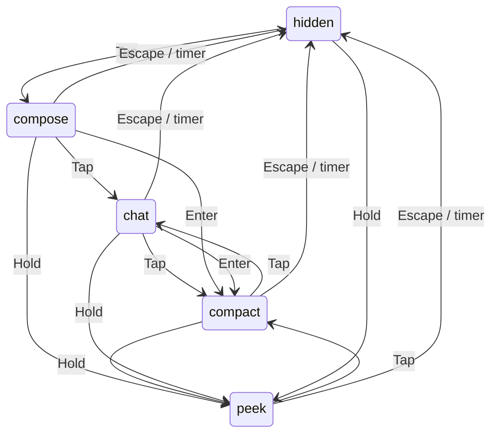

# Scenariusze weryfikacji Voice Line

Sprawdzone względem kodu i zestawów testów: 11 października 2026.
Scenariusze dotyczą aplikacji desktop (`npm start`), chyba że wskazano CLI lub
konkretny tryb. LOCAL = `VOICE_MODE=local`; API = `VOICE_MODE=realtime`.
Zmiana trybu wymaga restartu. Pokrycie oznacza zakres istniejących testów,
nie potwierdzenie wykonania wszystkich scenariuszy na rzeczywistych usługach.

## Copilot: kontrakt interakcji

Stan pracy i widok są niezależne. Orb i popup pojawiają się i znikają razem.

| Tryb | Zawartość | Krótki Copilot przy gotowej aplikacji |
| --- | --- | --- |
| hidden | Obie powierzchnie ukryte | compose |
| compose | Samo pole, ewentualnie status lub błąd | chat |
| peek | Najnowsza tura/status, bez pola | compact |
| compact | Najnowsza tura i pole | chat |
| chat | Cała rozmowa i pole | compact |

Wciśnięcie Copilota natychmiast przerywa pracę. Tap (<250 ms) odrzuca audio;
hold (>=250 ms) pokazuje peek, zachowuje szkic i nagrywa od key-down.
Puszczenie po hold wysyła nagranie. Repeats nie uruchamiają kolejnych działań.
Klik orba wykonuje tap bez nagrywania. Tray otwiera chat.

Przed rzeczywistym rozpoczęciem playbacku przerwanie usuwa bieżącą turę
z historii, zapisu i kontekstu. Tap czyści szkic i zachowuje zakres chat/compact;
z peek dodaje pole w compact, z hidden otwiera compose. Nie przełącza dodatkowo
widoków. Po rozpoczęciu playbacku tura zostaje: LOCAL zachowuje pełną odpowiedź,
API otrzymany fragment z oznaczeniem „Odpowiedź przerwana”. Tap także czyści szkic.
Następne pytanie jest kontynuacją. Sam hold nie czyści szkicu.

Wysłanie tekstu pokazuje compact; odpowiedź tekstowa nie uruchamia odczytu.
Enter wysyła, Shift+Enter dodaje linię, IME nie wysyła. Błędne wysłanie zachowuje
szkic. Podczas startu/awarii tap otwiera pole ze statusem, wysyłanie jest zablokowane;
hold pokazuje stan bez nagrywania. Gotowość w trakcie gestu nie rozpoczyna nagrania.

Escape ukrywa oba elementy, usuwa pin i fokus, zachowuje szkic i nie przerywa pracy.
Aktualizacje tej samej pracy nie otwierają interfejsu. Nowe pytanie lub jawne otwarcie
może go pokazać. Hover nie otwiera ukrytego interfejsu.

Po zakończeniu lub przerwaniu aktywnej pracy działa jeden timer 5 sekund.
Jeśli przy jego wygaśnięciu jest hover, fokus pola lub pin, okno zostaje do jawnego
zamknięcia albo następnej pracy. Unhover, blur i unpin nie uruchamiają timera.
Nowa praca unieważnia stary timer. Błędy pozostają do zamknięcia lub kolejnej akcji.

Wycofanie korzysta z checkpointu danej operacji; spóźniony commit jest odrzucany.
Po korekcie trwałe localContextIds kierują kolejne żądania do świeżego wątku
z kontekstem zachowanych lokalnych tur. Mapowanie dostawcy i rejestr retencji
zmieniają się atomowo; stare wątki pozostają zarejestrowane do czyszczenia.

## Diagram widoków

Tap podczas pracy stosuje regułę poprawki/kontynuacji zamiast przełączenia.
LOCAL: listening → transcribing → thinking → preparing-speech → speaking → idle.
API pomija lokalne STT/TTS. Tekst nie uruchamia odczytu.

## Jak czytać pokrycie

`overlay` = `npm test -- test-overlay.cjs`, deterministyczne testy kontrolera i zegara.
`desktop` = `npm run test:desktop`, prawdziwe okna Electron z symulowanymi stanami silnika.
`copilot` i `audio-levels` = pliki `test-copilot.ts` i `test-audio-levels.ts`
wybierane przez `npm test -- <plik>`; `keyboard` = `npm run test:keyboard`.
`speaker` = `npm run test:integration -- test-speaker.ts`.
Pozostałe skróty w tabelach oznaczają:

| Skrót | Pliki / polecenie |
| --- | --- |
| `controller` | `tests/unit/test-application-controller.ts` |
| `voice-engine` | `tests/unit/test-voice-engine.ts` |
| `supervisor` | `tests/unit/test-engine-supervisor.cjs` |
| `storage` | `test-app-storage.ts`, `test-storage-coordination.ts`, `test-storage-migration.ts`, `test-retention-recovery.ts`, `test-session-commit.ts` w `tests/unit/` |
| `conversation` | `test-conversation-session.ts`, `test-conversation-model.ts`, `test-conversation-context.ts` w `tests/unit/` |
| `realtime` | `test-realtime.ts`, `test-realtime-completion.ts` w `tests/unit/` |
| `images` | `tests/unit/test-images.ts` |
| `storage-wire` | `npm run test:integration -- test-storage-wire.ts` |
| `realtime-wire` | `npm run test:integration -- test-realtime-wire.ts` |

Pliki jednostkowe można wybrać przez `npm test -- <plik>`.
`speaker` uruchamia mock procesu PowerShell; nie sprawdza prawdziwego SAPI ani
fizycznego odtwarzania. `desktop` używa mocków zapisu schowka i dialogów zapisu;
nie zmienia schowka użytkownika. `keyboard` instaluje natywne hooki i wstrzykuje
F24/F22, więc wymaga osobnego uruchomienia na interaktywnym pulpicie Windows.
Automatyczne pokrycie stanu UI nie potwierdza działania fizycznego mikrofonu,
klawisza ani usług STT/Codex/TTS. Kolumna ręczna wskazuje dodatkową kontrolę,
którą należy wykonać z uruchomioną aplikacją; nie oznacza, że została wykonana.

`npm test` uruchamia pliki `test-*` z `tests/unit/`, w tym testy narzędzi i izolacji środowiska.
`npm run check` łączy typecheck i ten zestaw. `npm run test:integration`
uruchamia mock speakera, storage-wire i realtime-wire z `tests/integration/`;
wymaga PowerShell, Codex i FFplay, ale używa symulowanych providerów i nie
wykonuje płatnej inferencji. FFplay otwiera wyjście audio dla testowego PCM.
Test klawiatury jest w `tests/native/`, a pomocnicze fixture i skrypty
w `tests/helpers/`. Smoke Electron jest w `tests/native/desktop-smoke.cjs`;
runner uruchamia produkcyjny host `electron/orb-main.cjs` z `--smoke-test`,
który przekazuje harnessowi rzeczywiste okna i adaptery.
Smoke mierzy też historię dla 100, 1000 i 3000 wymian, zachowanie istniejących
węzłów i leniwe podglądy obrazów; zapisuje `history-scale.json` obok zrzutów.

Runner nie ładuje `.env`, usuwa odziedziczone klucze API oraz ustawia tymczasowe
`APP_DATA_DIR`, `CODEX_HOME` i `CODEX_SQLITE_HOME`. Testy tworzące mock
logowania ustawiają własny fikcyjny klucz. Dane i profile testowe są usuwane po
zakończeniu; zrzuty desktop zostają w `.app-data/test-results/desktop-<id>/`.
`preview:desktop` i `preview:web` służą do podglądu, a `probe:imagegen` oraz
`probe:image-history` są jawnymi eksperymentami poza automatycznymi zestawami.

## Kulka, popup i czas odpowiedzi

| ID | Kroki | Oczekiwany wynik | Pokrycie / kontrola ręczna |
| --- | --- | --- | --- |
| V01 | Start aplikacji. | Obie ukryte; Copilot może pokazać stan startu. | controller, desktop |
| V02 | Hold bez hoveru. | Obie widoczne, peek bez przejęcia fokusu. | copilot, overlay; ręcznie mikrofon |
| V03 | Opuść powierzchnie w każdym aktywnym stanie. | Obie pozostają; brak timera unhover. | overlay, desktop |
| V04 | Pełny cykl LOCAL. | Widok nie zmienia się między etapami. | voice-engine; ręcznie usługi |
| V05 | Koniec pracy bez hoveru, fokusu i pina. | Obie znikają po 5 sekundach. | overlay, desktop |
| V06 | Hover przy wygaśnięciu timera, potem odejdź. | Obie pozostają do zamknięcia/nowej pracy. | overlay |
| V07 | Fokus pola przy wygaśnięciu, potem blur. | Brak ukrycia po utracie fokusu. | overlay, desktop |
| V08 | Pin przy wygaśnięciu, potem unpin. | Brak ukrycia po odpięciu. | overlay, desktop |
| V09 | Hover nad ukrytym interfejsem. | Nie otwiera powierzchni. | overlay, desktop |
| V10 | Przejdź między orbem a popupem. | Hover obu chroni przy wygaśnięciu. | overlay, desktop |
| V11 | Klikaj orb przy gotowej aplikacji. | Przejścia jak tap; szkic zachowany. | overlay, desktop |
| V12 | Escape podczas odpowiedzi. | Obie ukryte, praca trwa. | overlay; ręcznie odczyt |
| V13 | Nowe nagranie przed starym timerem. | Stary timer nie ukrywa nowej pracy. | overlay |
| V14 | Tekst z compose/chat. | compact, anulowany stary timer. | overlay, desktop |
| V15 | Snapshoty i audio-levels. | Brak zmiany widoku i przejęcia fokusu. | desktop |
| V16 | Zmiana fokusu podczas odpowiedzi. | Praca trwa, brak timera blur. | overlay; ręcznie dwa okna |
| V17 | Pin i Escape. | Escape usuwa pin i ukrywa oba. | overlay, desktop |
| V18 | Tap podczas odczytu. | Puste pole, zachowana odpowiedź; compact lub chat. | controller, desktop |
| V19 | Escape, dalsze aktualizacje i koniec pracy. | Obie pozostają ukryte. | overlay |

## Wejście i kolejne rozmowy

| ID | Kroki | Oczekiwany wynik | Pokrycie / kontrola ręczna |
| --- | --- | --- | --- |
| I01 | Z ukrycia krótko naciśnij Copilot (<250 ms). | Skupione pole tekstowe, widoczna kulka; próbki odrzucone, brak STT. | copilot, overlay, desktop; ręcznie klawisz |
| I02 | W LOCAL przytrzymaj Copilot >=250 ms; mów; puść. | Nagrywanie, potem STT, generowanie, przygotowanie głosu i odczyt w tej kolejności. | copilot, controller, voice-engine; ręcznie pełny cykl |
| I03 | Wyślij tekst Enterem w LOCAL i API. | Nowe pytanie w rozmowie; przygotowanie odpowiedzi; bez odczytu TTS. | desktop, controller, voice-engine; ręcznie Codex |
| I04 | Enter na pustym polu, szybki podwójny Enter, Shift+Enter, Enter podczas IME. | Brak pustych i podwójnych wysłań; nowa linia działa; IME nie wysyła. | desktop (puste, duplikaty, IME); ręcznie Shift+Enter |
| I05 | Zamknij popup ze szkicem i otwórz go ponownie. | Szkic zachowany; brak samoczynnego wysłania. | desktop |
| I06 | Spróbuj wysłać tekst przy niedostępnym silniku. | Szkic pozostaje; czytelny błąd z możliwością odzyskania. | desktop |
| I07 | Otwórz rozmowę z traya lub klawiaturą. | Ten sam tryb `chat`; poprawny fokus pola. | desktop (otwarcie); ręcznie tray i klawiatura |
| I08 | Wyślij kilka pytań; przewiń do wcześniejszej odpowiedzi; zmień stan silnika. | Historia zachowana; stan nie przewija użytkownika do dołu. | desktop |
| I09 | Wybierz Nowa rozmowa lub Ctrl+Shift+N podczas odpowiedzi. | Bieżąca praca przerwana; kontekst i wyświetlana historia wyczyszczone; poprzednią rozmowę można przywrócić. | controller, storage, desktop (reset widoku); ręcznie menu i skrót |

## Przerwanie, błędy i zamknięcie

| ID | Kroki | Oczekiwany wynik | Pokrycie / kontrola ręczna |
| --- | --- | --- | --- |
| E01 | Przerwij przez tray w trakcie STT, generowania lub odczytu. | Bieżąca praca zatrzymana; spóźniony wynik nie zastępuje nowej rozmowy. | controller, speaker (anulowanie mocka procesu); ręcznie wszystkie etapy |
| E02 | Naciśnij i przytrzymaj Copilot podczas odczytu poprzedniej odpowiedzi. | Odczyt przerwany już przy naciśnięciu; nowe nagrywanie po progu 250 ms; nowy cykl widoczny. | controller, speaker (mock), copilot; ręcznie cały cykl |
| E03 | W LOCAL puść klawisz po nagraniu ciszy. | Brak odpowiedzi na nierozpoznaną mowę; informacja o błędzie; można ponowić. | voice-engine (pusty wynik STT); ręcznie mikrofon i Whisper |
| E04 | Sprawdź błąd STT, Codex i TTS osobno oraz przekroczenie limitu operacji. | Brak nieskończonego aktywnego stanu; komunikat odzyskania; spóźniony wynik po anulowaniu ignorowany. | controller (limit), voice-engine (anulowanie); ręcznie kontrolowane błędy usług |
| E05 | Zatrzymaj proces silnika; wybierz ponowienie także szybko dwa razy. | Błąd gotowości; pojedynczy restart; bez powielenia usług i spóźnionych komunikatów starego procesu. | supervisor; ręcznie menu i rzeczywiste usługi |
| E06 | Szybko ukryj i ponownie otwórz popup. | Stare opóźnione resetowanie nie zamyka ani nie czyści nowego widoku. | desktop |
| E07 | Zamknij aplikację podczas nagrywania lub odczytu. | Usługi i hook klawiatury zatrzymane; animacja kończy się; proces nie zostaje. | desktop (animacja), keyboard (hook); ręcznie aktywny cykl |

## Dźwięk, ruch i geometria

| ID | Kroki | Oczekiwany wynik | Pokrycie / kontrola ręczna |
| --- | --- | --- | --- |
| A01 | Mów cicho, głośniej i z pauzami. | Skala odpowiada głośności, wraca do bazowej w ciszy; klik nie przesuwa się. | audio-levels, desktop; ręcznie mikrofon |
| A02 | Odczytaj odpowiedź przez SAPI; opcjonalnie sprawdź Piper. | Animacja śledzi odtwarzane próbki; poziom resetowany na końcu/przerwaniu. | speaker (mock PCM), desktop; ręcznie synchronizacja obu silników |
| A03 | Włącz ograniczony ruch. | Brak skalowania, obrotu pierścienia i ruchu chmur; funkcje nadal działają. | desktop |
| A04 | Wstrzymaj animację przez tray. | Ruch zamrożony; samo wstrzymanie animacji nie zmienia głosowego cyklu. | desktop (atrybut pauzy); ręcznie tray |
| A05 | Długa odpowiedź i wiele wymian, mała dostępna wysokość ekranu. | Dostępne przewijanie; composer osiągalny; brak poziomego overflow. | desktop; ręcznie mały ekran |
| A06 | Zmień monitor, DPI i obszar roboczy. | Kulka i popup w obszarze ekranu; przechodzenie kursorem nadal działa. | ręcznie Windows |

## Osobna historia i zapis rozmowy

| ID | Kroki | Oczekiwany wynik | Pokrycie / kontrola ręczna |
| --- | --- | --- | --- |
| H01 | Uruchom LOCAL i realtime z różnych katalogów projektu. | Dane w katalogu aplikacji; LOCAL używa obecnego logowania i ephemeral, realtime osobnego domu API. | storage, storage-wire |
| H02 | Nowa rozmowa, zamknij aplikację, uruchom ponownie, Wróć do poprzedniej rozmowy. | LOCAL i realtime przywracają lokalną historię zatwierdzonych wymian i kontekst; starszy realtime bez lokalnego pliku importuje historię Codex jeden raz. | storage, conversation, realtime, desktop |
| H03 | Przesuń zegar testowy o 24 godziny. | Wygasłe zarejestrowane wątki naprawdę usunięte; świeże i powiązane obrazy zachowane. | storage, storage-wire |
| H04 | Zapisz rozmowę… w menu; anuluj, zapisz tekst z obrazem, zasymuluj błąd pliku. | Anulowanie bez zmian, samodzielny plik Markdown, komunikat odzyskania po błędzie; zapis niedostępny w trakcie odpowiedzi. | storage, desktop |
| H05 | Odczekaj 120 sekund od ostatniej udanej odpowiedzi; zadaj nowe pytanie, potem wróć do poprzedniej rozmowy. | Nowe pytanie zaczyna pusty kontekst; powrót odtwarza zatwierdzone wymiany i odnawia okno kontekstu. Restart zachowuje zapisany termin. | conversation, storage, controller; ręcznie upływ czasu |
| H06 | W fixture uszkodź plik bieżącej lub poprzedniej rozmowy; osobno zasymuluj błąd usuwania historii. | Uszkodzony plik LOCAL/ImageGen zachowany jako `.json.corrupt-<id>` obok oryginalnej ścieżki; druga rozmowa nie ginie. Nieudane sprzątanie pozostaje do ponowienia; cudza historia i współdzielone obrazy pozostają. | storage; ręcznie komunikaty odzyskania |
| H07 | Załaduj 100, 1000 i 3000 wymian z obrazami; zaktualizuj ostatnią odpowiedź i przewijaj. | Istniejące węzły historii zachowane; dopisywane tylko nowe wymiany; podglądy obrazów ładowane leniwie. Pełna historia pozostaje zapisana mimo ograniczenia kontekstu wysyłanego do modelu. | desktop (`history-scale.json`), conversation; ręcznie płynność |

## Realtime (API)

| ID | Kroki | Oczekiwany wynik | Pokrycie / kontrola ręczna |
| --- | --- | --- | --- |
| R01 | Uruchom `VOICE_MODE=realtime`; sprawdź etykietę i usługi, następnie nagraj pytanie. | Etykieta API; Whisper, SAPI i Piper nie startują. Po `listening` następuje `thinking`, potem strumieniowy odczyt przez FFplay (`speaking`). | voice-engine, realtime, realtime-wire; ręcznie API i urządzenia |
| R02 | Obserwuj transkrypty i odczyt dłuższej odpowiedzi. | Częściowy tekst jest aktualizowany bez duplikowania; `idle` dopiero po zakończeniu strumienia i opróżnieniu kolejki odtwarzania. | voice-engine, realtime, realtime-wire; ręcznie synchronizacja |
| R03 | Przerwij Copilotem przed odczytem i po jego rozpoczęciu; osobno sprawdź reset. | Przed odczytem tura usunięta; po rozpoczęciu zapisany dostępny fragment z oznaczeniem przerwania. Sesja i audio zatrzymane, stare callbacki ignorowane. Reset rozpoczyna nową rozmowę. | controller, realtime, copilot-history; ręcznie API |
| R04 | Po udanej odpowiedzi głosowej zadaj pytanie tekstowe, uruchom ponownie i użyj powrotu do rozmowy. | Tekst bez odczytu; kolejne audio otrzymuje kontekst zatwierdzonych wymian głosowych i tekstowych, także po restarcie i powrocie. | realtime, conversation, realtime-wire; ręcznie API |

## Obrazy i treść odpowiedzi

| ID | Kroki | Oczekiwany wynik | Pokrycie / kontrola ręczna |
| --- | --- | --- | --- |
| G01 | W LOCAL wyślij `/image kot w kosmosie`; osobno poproś naturalnym językiem przez tekst i głos. | `/image` wybiera generowanie jawnie; naturalną prośbę obsługuje zwykły turn Codex, który może wybrać ImageGen. Udany wynik pokazuje PNG z przyciskiem zapisu. | voice-engine, images, desktop (podgląd); ręcznie ImageGen i oba backendy LOCAL |
| G02 | W API poproś głosowo „Wygeneruj obraz kota w kosmosie”; osobno zadaj pytanie o obraz bez żądania generowania. | Dopiero finalny transkrypt jawnego żądania zatrzymuje realtime i uruchamia osobne zadanie ImageGen z logowaniem ChatGPT. Potwierdzenie tekstowe bez kolejnego odczytu; pytanie o obraz pozostaje zwykłym pytaniem. | images, voice-engine; ręcznie API i ImageGen |
| G03 | Zapisz obraz; anuluj dialog; zasymuluj brak PNG. | Anulowanie bez zapisu; sukces zapisuje właściwy PNG; brak obrazu pokazuje komunikat i wyłącza zapis. Renderer przekazuje wyłącznie ID artefaktu. | images, desktop |
| G04 | Zresetuj rozmowę z obrazem, wróć do niej po restarcie i zadaj dalsze pytanie. | Obraz odtworzony we właściwej wymianie; kontekst zawiera tekst zadania, bez pikseli. Retencja nie usuwa PNG używanego przez inną zachowaną rozmowę. | images, storage, conversation; ręcznie pełny cykl |
| G05 | Wyświetl odpowiedź z HTML, kodem i długą linią; skopiuj kod, także przy błędzie schowka. | Treść nie wykonuje HTML; kod zachowuje białe znaki, przewija się we własnym bloku i kopiuje dokładnie. Błąd kopiowania podpowiada Ctrl+C. LOCAL TTS pomija bloki kodu. | desktop, `test-answers.js`, `test-clipboard.cjs`; ręcznie odczyt |

## Minimalna regresja po zmianach

Uruchom `npm run check`. Po zmianach UI dodaj `npm run test:desktop` na
interaktywnym pulpicie; dla wejścia także `npm run test:keyboard`.
Dla zmian procesu TTS, storage albo protokołu Codex uruchom odpowiedni test
z `tests/integration/` lub całą grupę `npm run test:integration`, po zainstalowaniu
jej zależności, np. `npm run test:integration -- test-storage-wire.ts`.
`test-speaker.ts` weryfikuje mock procesu, nie prawdziwy dźwięk.
Następnie ręcznie sprawdź V03, V04, V06, V12, I02, E02 oraz A01–A03 z rzeczywistymi usługami.
Po zmianach podtrzymania popupu dodaj V05, V07, V08 i V17–V19.
Po zmianach realtime dodaj R01–R04 i `test-realtime-wire.ts`; po zmianach obrazów
G01–G04 oraz testy `images` i desktop. Historia wymaga H02–H07 i `storage-wire`.
Testy jednostkowe i wire używają fixture lub symulowanych providerów; scenariusze
ręczne API/ImageGen korzystają z rzeczywistego konta i mogą zużywać jego limity.

Przy zgłoszeniu zapisz ID scenariusza, stan silnika, tryb popupu, pozycję kursora,
czas od opuszczenia powierzchni i oczekiwany/rzeczywisty wynik. Nie zapisuj sekretów
z `.env`. Nowy przypadek wyścigu dodaj do testów kontrolera z wirtualnym zegarem.

## Korekta i kontynuacja

| ID | Kroki | Oczekiwany wynik | Pokrycie |
| --- | --- | --- | --- |
| C01 | Tap podczas STT/thinking/preparing-speech. | Tura wycofana, szkic pusty, wcześniejsze tury zachowane. | controller, copilot-history |
| C02 | Restart po korekcie, nowe pytanie. | Wycofana tura nie wraca do historii ani kontekstu. | copilot-history |
| C03 | Przerwij API po początku odczytu. | Fragment oznaczony; bez podwójnego/spóźnionego commitu. | copilot-history; ręcznie API |
| C04 | Hold ze szkicem, potem tap przerywający. | Hold zachowuje szkic; tap podczas pracy go czyści. | desktop; ręcznie klawisz |
| C05 | Hold przy niedostępności, gotowość przed puszczeniem. | Brak nagrania; nowy gest wymagany. | controller |

copilot-history = tests/unit/test-copilot-history.ts. Testy automatyczne nie
potwierdzają fizycznego klawisza, mikrofonu ani usług LOCAL/API.
