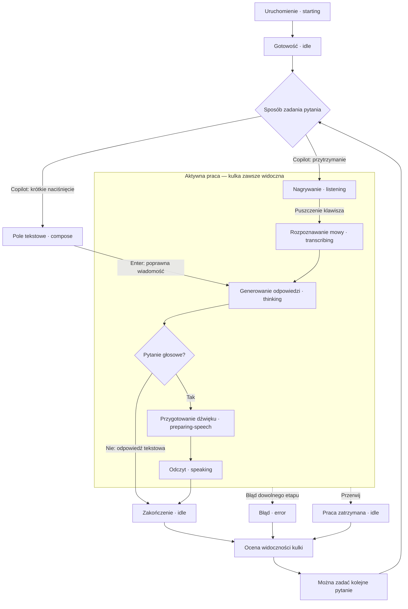
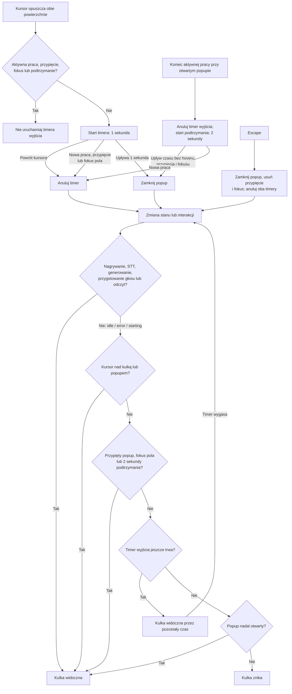
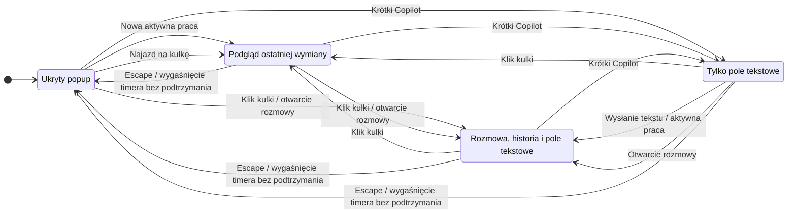

# Scenariusze weryfikacji Voice Line

Sprawdzone względem kodu i zestawów testów: 11 października 2026.
Scenariusze dotyczą aplikacji desktop (`npm start`), chyba że wskazano CLI lub
konkretny tryb. LOCAL = `VOICE_MODE=local`; API = `VOICE_MODE=realtime`.
Zmiana trybu wymaga restartu. Pokrycie oznacza zakres istniejących testów,
nie potwierdzenie wykonania wszystkich scenariuszy na rzeczywistych usługach.

## Reguły widoczności

Kulka pozostaje widoczna w każdym aktywnym stanie: `listening`, `transcribing`,
`thinking`, `preparing-speech`, `speaking`. Zejście myszką ani Escape nie mogą
ukryć aktywnej kulki. Nowa praca otwiera ukryty popup w `peek`; `compose`
przechodzi w `chat`. Opuszczenie obu powierzchni nie zamyka popupu podczas pracy.
Escape zamyka go od razu, usuwa przypięcie i podtrzymanie przez fokus.
Ukrycie popupu nie przerywa pracy.

Po zakończeniu pracy (`idle` lub `error`):

- Jeśli popup jest otwarty przy wyjściu z aktywnego stanu, zaczyna się nowe
  2-sekundowe podtrzymanie popupu i kulki, także po błędzie lub przerwaniu.
- Po tych 2 sekundach popup i kulka znikają, chyba że utrzymuje je hover,
  przypięcie albo fokus pola tekstowego.
- Zejście kursorem podczas podtrzymania nie skraca jego czasu. Po jego wygaśnięciu
  późniejsze opuszczenie obu powierzchni uruchamia zwykły timer 1 sekundy.
- Jeśli popup został zamknięty przed końcem pracy, podtrzymanie nie startuje;
  bez hoveru kulka znika po zakończeniu pracy.
- Przypięty popup lub skupione pole tekstowe pozostają widoczne mimo zejścia.
  Odpięcie lub utrata fokusu przy braku hoveru uruchamia timer 1 sekundy,
  o ile nie trwa praca ani podtrzymanie po jej zakończeniu.
- Jawne otwarcie bez późniejszego opuszczenia powierzchni nie uruchamia timera.

Nowa praca głosowa lub tekstowa unieważnia timer wyjścia i podtrzymanie poprzedniej pracy.
Powtarzane snapshoty i zmiana głośności nie przejmują fokusu ani nie zmieniają trybu.
Właścicielem tych reguł jest `electron/overlay-controller.cjs`.

## Diagram: cykl rozmowy LOCAL

Aktywne etapy utrzymują kulkę niezależnie od kursora. Po zakończeniu, błędzie
lub przerwaniu jej widoczność wyznaczają reguły z następnego diagramu.
Powiązane scenariusze: V01–V08, I01–I03, E01–E04.
API pomija lokalne STT i TTS: po `listening` następuje `thinking`, a odtwarzanie
strumienia przechodzi w `speaking`. Tekst w obu trybach nie uruchamia odczytu.
Żądania obrazów opisują G01–G04; głosowe API może zakończyć je bez `speaking`.

## Diagram: kiedy kulka może zniknąć

Reguła jest oceniana przy zmianie stanu, hoveru, trybu popupu i wygaśnięciu timera.
Powiązane scenariusze: V03–V10, V12–V19.

Podtrzymanie liczy się od przejścia z aktywnego stanu do nieaktywnego, nie od
zejścia myszką. Powtórzony snapshot `idle` nie rozpoczyna go ponownie.
Czasy dotyczą kontrolera; natywne okno kulki kończy jeszcze animację wyjścia.

## Diagram: tryby popupu

`hidden` oznacza ukryty popup; kulka może nadal być widoczna podczas pracy.
Hover nie przejmuje fokusu i nie zwija otwartego `chat` ani `compose`.
Powiązane scenariusze: V09–V15, I01, I05–I08, E06.

Przypięcie i fokus są osobnymi właściwościami, nie dodatkowymi trybami popupu.
Timer wyjścia działa tylko bez pracy, podtrzymania, przypięcia i fokusu;
timer końca pracy zamyka popup tylko bez hoveru, przypięcia i fokusu.

## Jak czytać pokrycie

`overlay` = `npm test -- test-overlay.cjs`, deterministyczne testy kontrolera i zegara.
`desktop` = `npm run test:desktop`, prawdziwe okna Electron z symulowanymi stanami silnika.
`copilot` i `audio-levels` = pliki `test-copilot.ts` i `test-audio-levels.ts`
wybierane przez `npm test -- <plik>`; `keyboard` = `npm run test:keyboard`.
`speaker` = `npm run test:integration -- test-speaker.ts`.
Pozostałe skróty w tabelach oznaczają:

| Skrót | Pliki / polecenie |
| --- | --- |
| `controller` | `tests/unit/test-application-controller.ts` |
| `voice-engine` | `tests/unit/test-voice-engine.ts` |
| `supervisor` | `tests/unit/test-engine-supervisor.cjs` |
| `storage` | `test-app-storage.ts`, `test-storage-coordination.ts`, `test-storage-migration.ts`, `test-retention-recovery.ts`, `test-session-commit.ts` w `tests/unit/` |
| `conversation` | `test-conversation-session.ts`, `test-conversation-model.ts`, `test-conversation-context.ts` w `tests/unit/` |
| `realtime` | `test-realtime.ts`, `test-realtime-completion.ts` w `tests/unit/` |
| `images` | `tests/unit/test-images.ts` |
| `storage-wire` | `npm run test:integration -- test-storage-wire.ts` |
| `realtime-wire` | `npm run test:integration -- test-realtime-wire.ts` |

Pliki jednostkowe można wybrać przez `npm test -- <plik>`.
`speaker` uruchamia mock procesu PowerShell; nie sprawdza prawdziwego SAPI ani
fizycznego odtwarzania. `desktop` używa mocków zapisu schowka i dialogów zapisu;
nie zmienia schowka użytkownika. `keyboard` instaluje natywne hooki i wstrzykuje
F24/F22, więc wymaga osobnego uruchomienia na interaktywnym pulpicie Windows.
Automatyczne pokrycie stanu UI nie potwierdza działania fizycznego mikrofonu,
klawisza ani usług STT/Codex/TTS. Kolumna ręczna wskazuje dodatkową kontrolę,
którą należy wykonać z uruchomioną aplikacją; nie oznacza, że została wykonana.

`npm test` uruchamia pliki `test-*` z `tests/unit/`, w tym testy narzędzi i izolacji środowiska.
`npm run check` łączy typecheck i ten zestaw. `npm run test:integration`
uruchamia mock speakera, storage-wire i realtime-wire z `tests/integration/`;
wymaga PowerShell, Codex i FFplay, ale używa symulowanych providerów i nie
wykonuje płatnej inferencji. FFplay otwiera wyjście audio dla testowego PCM.
Test klawiatury jest w `tests/native/`, a pomocnicze fixture i skrypty
w `tests/helpers/`. Smoke Electron jest w `tests/native/desktop-smoke.cjs`;
runner uruchamia produkcyjny host `electron/orb-main.cjs` z `--smoke-test`,
który przekazuje harnessowi rzeczywiste okna i adaptery.
Smoke mierzy też historię dla 100, 1000 i 3000 wymian, zachowanie istniejących
węzłów i leniwe podglądy obrazów; zapisuje `history-scale.json` obok zrzutów.

Runner nie ładuje `.env`, usuwa odziedziczone klucze API oraz ustawia tymczasowe
`APP_DATA_DIR`, `CODEX_HOME` i `CODEX_SQLITE_HOME`. Testy tworzące mock
logowania ustawiają własny fikcyjny klucz. Dane i profile testowe są usuwane po
zakończeniu; zrzuty desktop zostają w `.app-data/test-results/desktop-<id>/`.
`preview:desktop` i `preview:web` służą do podglądu, a `probe:imagegen` oraz
`probe:image-history` są jawnymi eksperymentami poza automatycznymi zestawami.

## Kulka, popup i czas odpowiedzi

| ID | Kroki | Oczekiwany wynik | Pokrycie / kontrola ręczna |
| --- | --- | --- | --- |
| V01 | Uruchom aplikację; poczekaj na gotowość. | Kulka i popup ukryte w `starting` i `idle`. | desktop; ręcznie start usług |
| V02 | Przytrzymaj Copilot do `listening` bez najeżdżania myszką. | Kulka widoczna; ukryty popup otwiera się w `peek` bez przejęcia fokusu. | overlay, desktop; ręcznie mikrofon |
| V03 | W każdym z pięciu aktywnych stanów najedź na kulkę, zjedź poza obie powierzchnie i odczekaj ponad sekundę. | Popup i kulka pozostają przez cały aktywny stan. | overlay, desktop; ręcznie długi odczyt |
| V04 | W LOCAL zjedź w trakcie nagrywania; przejdź przez STT, generowanie, przygotowanie głosu i odczyt. | Żadne przejście nie ukrywa popupu ani kulki; po pracy zaczynają się 2 sekundy podtrzymania. | overlay, voice-engine; ręcznie cały cykl |
| V05 | Zakończ odczyt bez wcześniejszego hoveru, bez przypięcia i fokusu pola. | Otwarty popup i kulka zostają przez 2 sekundy od końca pracy, potem znikają. | overlay, desktop |
| V06 | Zakończ odczyt, trzymając kursor nad kulką lub popupem; pozostań tam ponad 2 sekundy, potem zjedź. | Popup i kulka zostają; po zejściu znikają po sekundzie, o ile nie są przypięte i pole nie ma fokusu. | overlay, desktop |
| V07 | Zjedź podczas odczytu; zakończ go po 500 ms, bez przypięcia i fokusu pola. | Od zakończenia zaczyna się pełne 2-sekundowe podtrzymanie. | overlay |
| V08 | Zjedź podczas odczytu; zakończ go po ponad sekundzie, bez przypięcia i fokusu pola. | Popup i kulka zostają podczas odczytu i jeszcze 2 sekundy po jego końcu. | overlay, desktop |
| V09 | Zjedź i wróć przed upływem sekundy. | Ukrycie anulowane; brak migania. | overlay, desktop |
| V10 | Przejdź z kulki do popupu w czasie krótszym niż sekunda. | Popup i kulka zostają; liczy się hover obu powierzchni. | overlay, desktop |
| V11 | Kliknij kulkę, potem kliknij ponownie także w trakcie odczytu. | `chat` przełącza się w `peek`; szkic zostaje; aktywna kulka widoczna. | overlay, desktop |
| V12 | Naciśnij Escape w popupie podczas odpowiedzi. | Popup zamknięty; odczyt trwa i kulka pozostaje. | overlay; ręcznie Escape podczas odczytu |
| V13 | Rozpocznij kolejne nagrywanie przed wygaśnięciem timera wyjścia w idle lub podtrzymania po odpowiedzi. | Stary timer anulowany; nie ukrywa popupu ani kulki nowej pracy. | overlay, desktop |
| V14 | Po zejściu z pola tekstowego wyślij pytanie tuż przed wygaśnięciem timera. | Nowa praca anuluje stary timer; rozmowa widoczna. | overlay |
| V15 | Zostaw nieruchomy kursor w popupie; rozpocznij kolejne pytanie, które zmienia wysokość okna. | Brak fałszywego wyjścia kursora, ukrycia i przejęcia fokusu. | overlay, desktop |
| V16 | W trakcie odpowiedzi kliknij inne okno. | Zmiana fokusu nie przerywa ani nie ukrywa aktywnej kulki. | ręcznie, dwa okna |
| V17 | Przypnij popup, zjedź, zmień fokus okna i zakończ odpowiedź; potem odepnij w idle bez hoveru i fokusu pola. | Przypięcie utrzymuje popup i kulkę; odpięcie przywraca ukrycie po sekundzie. Escape usuwa przypięcie. | overlay, desktop |
| V18 | Przerwij odczyt krótkim Copilotem; pisz w skupionym polu poza hoverem ponad 2 sekundy, potem kliknij inne okno. | `compose` i szkic pozostają podczas pisania; utrata fokusu przywraca ukrycie po sekundzie. | overlay, controller, desktop |
| V19 | Zamknij popup Escape podczas pracy, pozostaw kursor poza powierzchniami i zakończ pracę. | Popup pozostaje ukryty; aktywna kulka znika po końcu bez 2-sekundowego podtrzymania. | overlay |

## Wejście i kolejne rozmowy

| ID | Kroki | Oczekiwany wynik | Pokrycie / kontrola ręczna |
| --- | --- | --- | --- |
| I01 | Krótko naciśnij Copilot (<250 ms). | Skupione pole tekstowe, widoczna kulka; próbki odrzucone, brak STT. | copilot, overlay, desktop; ręcznie klawisz |
| I02 | W LOCAL przytrzymaj Copilot >=250 ms; mów; puść. | Nagrywanie, potem STT, generowanie, przygotowanie głosu i odczyt w tej kolejności. | copilot, controller, voice-engine; ręcznie pełny cykl |
| I03 | Wyślij tekst Enterem w LOCAL i API. | Nowe pytanie w rozmowie; przygotowanie odpowiedzi; bez odczytu TTS. | desktop, controller, voice-engine; ręcznie Codex |
| I04 | Enter na pustym polu, szybki podwójny Enter, Shift+Enter, Enter podczas IME. | Brak pustych i podwójnych wysłań; nowa linia działa; IME nie wysyła. | desktop (puste, duplikaty, IME); ręcznie Shift+Enter |
| I05 | Zamknij popup ze szkicem i otwórz go ponownie. | Szkic zachowany; brak samoczynnego wysłania. | desktop |
| I06 | Spróbuj wysłać tekst przy niedostępnym silniku. | Szkic pozostaje; czytelny błąd z możliwością odzyskania. | desktop |
| I07 | Otwórz rozmowę z traya lub klawiaturą. | Ten sam tryb `chat`; poprawny fokus pola. | desktop (otwarcie); ręcznie tray i klawiatura |
| I08 | Wyślij kilka pytań; przewiń do wcześniejszej odpowiedzi; zmień stan silnika. | Historia zachowana; stan nie przewija użytkownika do dołu. | desktop |
| I09 | Wybierz Nowa rozmowa lub Ctrl+Shift+N podczas odpowiedzi. | Bieżąca praca przerwana; kontekst i wyświetlana historia wyczyszczone; poprzednią rozmowę można przywrócić. | controller, storage, desktop (reset widoku); ręcznie menu i skrót |

## Przerwanie, błędy i zamknięcie

| ID | Kroki | Oczekiwany wynik | Pokrycie / kontrola ręczna |
| --- | --- | --- | --- |
| E01 | Przerwij przez tray w trakcie STT, generowania lub odczytu. | Bieżąca praca zatrzymana; spóźniony wynik nie zastępuje nowej rozmowy. | controller, speaker (anulowanie mocka procesu); ręcznie wszystkie etapy |
| E02 | Naciśnij i przytrzymaj Copilot podczas odczytu poprzedniej odpowiedzi. | Odczyt przerwany już przy naciśnięciu; nowe nagrywanie po progu 250 ms; nowy cykl widoczny. | controller, speaker (mock), copilot; ręcznie cały cykl |
| E03 | W LOCAL puść klawisz po nagraniu ciszy. | Brak odpowiedzi na nierozpoznaną mowę; informacja o błędzie; można ponowić. | voice-engine (pusty wynik STT); ręcznie mikrofon i Whisper |
| E04 | Sprawdź błąd STT, Codex i TTS osobno oraz przekroczenie limitu operacji. | Brak nieskończonego aktywnego stanu; komunikat odzyskania; spóźniony wynik po anulowaniu ignorowany. | controller (limit), voice-engine (anulowanie); ręcznie kontrolowane błędy usług |
| E05 | Zatrzymaj proces silnika; wybierz ponowienie także szybko dwa razy. | Błąd gotowości; pojedynczy restart; bez powielenia usług i spóźnionych komunikatów starego procesu. | supervisor; ręcznie menu i rzeczywiste usługi |
| E06 | Szybko ukryj i ponownie otwórz popup. | Stare opóźnione resetowanie nie zamyka ani nie czyści nowego widoku. | desktop |
| E07 | Zamknij aplikację podczas nagrywania lub odczytu. | Usługi i hook klawiatury zatrzymane; animacja kończy się; proces nie zostaje. | desktop (animacja), keyboard (hook); ręcznie aktywny cykl |

## Dźwięk, ruch i geometria

| ID | Kroki | Oczekiwany wynik | Pokrycie / kontrola ręczna |
| --- | --- | --- | --- |
| A01 | Mów cicho, głośniej i z pauzami. | Skala odpowiada głośności, wraca do bazowej w ciszy; klik nie przesuwa się. | audio-levels, desktop; ręcznie mikrofon |
| A02 | Odczytaj odpowiedź przez SAPI; opcjonalnie sprawdź Piper. | Animacja śledzi odtwarzane próbki; poziom resetowany na końcu/przerwaniu. | speaker (mock PCM), desktop; ręcznie synchronizacja obu silników |
| A03 | Włącz ograniczony ruch. | Brak skalowania, obrotu pierścienia i ruchu chmur; funkcje nadal działają. | desktop |
| A04 | Wstrzymaj animację przez tray. | Ruch zamrożony; samo wstrzymanie animacji nie zmienia głosowego cyklu. | desktop (atrybut pauzy); ręcznie tray |
| A05 | Długa odpowiedź i wiele wymian, mała dostępna wysokość ekranu. | Dostępne przewijanie; composer osiągalny; brak poziomego overflow. | desktop; ręcznie mały ekran |
| A06 | Zmień monitor, DPI i obszar roboczy. | Kulka i popup w obszarze ekranu; przechodzenie kursorem nadal działa. | ręcznie Windows |

## Osobna historia i zapis rozmowy

| ID | Kroki | Oczekiwany wynik | Pokrycie / kontrola ręczna |
| --- | --- | --- | --- |
| H01 | Uruchom LOCAL i realtime z różnych katalogów projektu. | Dane w katalogu aplikacji; LOCAL używa obecnego logowania i ephemeral, realtime osobnego domu API. | storage, storage-wire |
| H02 | Nowa rozmowa, zamknij aplikację, uruchom ponownie, Wróć do poprzedniej rozmowy. | LOCAL i realtime przywracają lokalną historię zatwierdzonych wymian i kontekst; starszy realtime bez lokalnego pliku importuje historię Codex jeden raz. | storage, conversation, realtime, desktop |
| H03 | Przesuń zegar testowy o 24 godziny. | Wygasłe zarejestrowane wątki naprawdę usunięte; świeże i powiązane obrazy zachowane. | storage, storage-wire |
| H04 | Zapisz rozmowę… w menu; anuluj, zapisz tekst z obrazem, zasymuluj błąd pliku. | Anulowanie bez zmian, samodzielny plik Markdown, komunikat odzyskania po błędzie; zapis niedostępny w trakcie odpowiedzi. | storage, desktop |
| H05 | Odczekaj 120 sekund od ostatniej udanej odpowiedzi; zadaj nowe pytanie, potem wróć do poprzedniej rozmowy. | Nowe pytanie zaczyna pusty kontekst; powrót odtwarza zatwierdzone wymiany i odnawia okno kontekstu. Restart zachowuje zapisany termin. | conversation, storage, controller; ręcznie upływ czasu |
| H06 | W fixture uszkodź plik bieżącej lub poprzedniej rozmowy; osobno zasymuluj błąd usuwania historii. | Uszkodzony plik LOCAL/ImageGen zachowany jako `.json.corrupt-<id>` obok oryginalnej ścieżki; druga rozmowa nie ginie. Nieudane sprzątanie pozostaje do ponowienia; cudza historia i współdzielone obrazy pozostają. | storage; ręcznie komunikaty odzyskania |
| H07 | Załaduj 100, 1000 i 3000 wymian z obrazami; zaktualizuj ostatnią odpowiedź i przewijaj. | Istniejące węzły historii zachowane; dopisywane tylko nowe wymiany; podglądy obrazów ładowane leniwie. Pełna historia pozostaje zapisana mimo ograniczenia kontekstu wysyłanego do modelu. | desktop (`history-scale.json`), conversation; ręcznie płynność |

## Realtime (API)

| ID | Kroki | Oczekiwany wynik | Pokrycie / kontrola ręczna |
| --- | --- | --- | --- |
| R01 | Uruchom `VOICE_MODE=realtime`; sprawdź etykietę i usługi, następnie nagraj pytanie. | Etykieta API; Whisper, SAPI i Piper nie startują. Po `listening` następuje `thinking`, potem strumieniowy odczyt przez FFplay (`speaking`). | voice-engine, realtime, realtime-wire; ręcznie API i urządzenia |
| R02 | Obserwuj transkrypty i odczyt dłuższej odpowiedzi. | Częściowy tekst jest aktualizowany bez duplikowania; `idle` dopiero po zakończeniu strumienia i opróżnieniu kolejki odtwarzania. | voice-engine, realtime, realtime-wire; ręcznie synchronizacja |
| R03 | Przerwij, zresetuj lub rozpocznij nowe nagrywanie w trakcie odpowiedzi API. | Odtwarzanie i sesja realtime zatrzymane; stare callbacki ignorowane; wymiana anulowana przed zatwierdzeniem nie trafia do trwałej historii. | controller, realtime, storage; ręcznie API |
| R04 | Po udanej odpowiedzi głosowej zadaj pytanie tekstowe, uruchom ponownie i użyj powrotu do rozmowy. | Tekst bez odczytu; kolejne audio otrzymuje kontekst zatwierdzonych wymian głosowych i tekstowych, także po restarcie i powrocie. | realtime, conversation, realtime-wire; ręcznie API |

## Obrazy i treść odpowiedzi

| ID | Kroki | Oczekiwany wynik | Pokrycie / kontrola ręczna |
| --- | --- | --- | --- |
| G01 | W LOCAL wyślij `/image kot w kosmosie`; osobno poproś naturalnym językiem przez tekst i głos. | `/image` wybiera generowanie jawnie; naturalną prośbę obsługuje zwykły turn Codex, który może wybrać ImageGen. Udany wynik pokazuje PNG z przyciskiem zapisu. | voice-engine, images, desktop (podgląd); ręcznie ImageGen i oba backendy LOCAL |
| G02 | W API poproś głosowo „Wygeneruj obraz kota w kosmosie”; osobno zadaj pytanie o obraz bez żądania generowania. | Dopiero finalny transkrypt jawnego żądania zatrzymuje realtime i uruchamia osobne zadanie ImageGen z logowaniem ChatGPT. Potwierdzenie tekstowe bez kolejnego odczytu; pytanie o obraz pozostaje zwykłym pytaniem. | images, voice-engine; ręcznie API i ImageGen |
| G03 | Zapisz obraz; anuluj dialog; zasymuluj brak PNG. | Anulowanie bez zapisu; sukces zapisuje właściwy PNG; brak obrazu pokazuje komunikat i wyłącza zapis. Renderer przekazuje wyłącznie ID artefaktu. | images, desktop |
| G04 | Zresetuj rozmowę z obrazem, wróć do niej po restarcie i zadaj dalsze pytanie. | Obraz odtworzony we właściwej wymianie; kontekst zawiera tekst zadania, bez pikseli. Retencja nie usuwa PNG używanego przez inną zachowaną rozmowę. | images, storage, conversation; ręcznie pełny cykl |
| G05 | Wyświetl odpowiedź z HTML, kodem i długą linią; skopiuj kod, także przy błędzie schowka. | Treść nie wykonuje HTML; kod zachowuje białe znaki, przewija się we własnym bloku i kopiuje dokładnie. Błąd kopiowania podpowiada Ctrl+C. LOCAL TTS pomija bloki kodu. | desktop, `test-answers.js`, `test-clipboard.cjs`; ręcznie odczyt |

## Minimalna regresja po zmianach

Uruchom `npm run check`. Po zmianach UI dodaj `npm run test:desktop` na
interaktywnym pulpicie; dla wejścia także `npm run test:keyboard`.
Dla zmian procesu TTS, storage albo protokołu Codex uruchom odpowiedni test
z `tests/integration/` lub całą grupę `npm run test:integration`, po zainstalowaniu
jej zależności, np. `npm run test:integration -- test-storage-wire.ts`.
`test-speaker.ts` weryfikuje mock procesu, nie prawdziwy dźwięk.
Następnie ręcznie sprawdź V03, V04, V06, V12, I02, E02 oraz A01–A03 z rzeczywistymi usługami.
Po zmianach podtrzymania popupu dodaj V05, V07, V08 i V17–V19.
Po zmianach realtime dodaj R01–R04 i `test-realtime-wire.ts`; po zmianach obrazów
G01–G04 oraz testy `images` i desktop. Historia wymaga H02–H07 i `storage-wire`.
Testy jednostkowe i wire używają fixture lub symulowanych providerów; scenariusze
ręczne API/ImageGen korzystają z rzeczywistego konta i mogą zużywać jego limity.

Przy zgłoszeniu zapisz ID scenariusza, stan silnika, tryb popupu, pozycję kursora,
czas od opuszczenia powierzchni i oczekiwany/rzeczywisty wynik. Nie zapisuj sekretów
z `.env`. Nowy przypadek wyścigu dodaj do testów kontrolera z wirtualnym zegarem.
