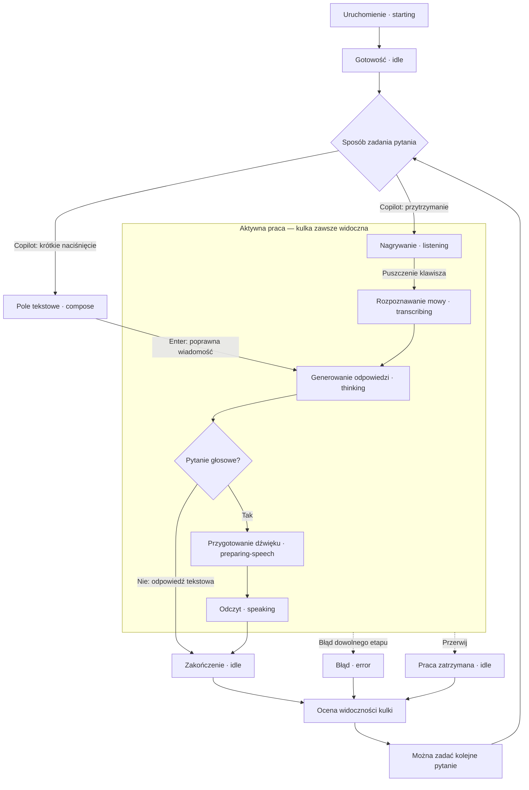
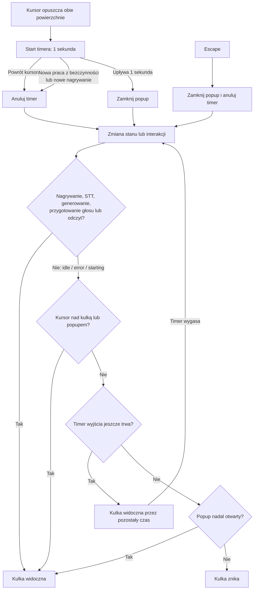
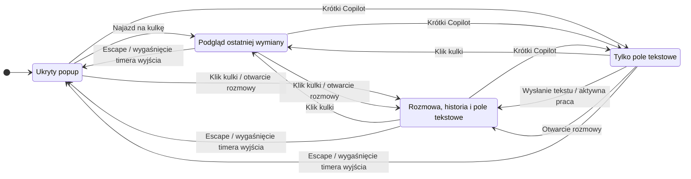

# Scenariusze weryfikacji Voice Line

## Reguły widoczności

Kulka pozostaje widoczna w każdym aktywnym stanie: `listening`, `transcribing`,
`thinking`, `preparing-speech`, `speaking`. Zejście myszką ani Escape nie mogą
ukryć aktywnej kulki. Popup może zamknąć się po 1 sekundzie od opuszczenia obu
powierzchni; Escape zamyka go od razu. Ukrycie popupu nie przerywa pracy.

Po zakończeniu pracy (`idle` lub `error`):

- Bez wcześniejszego hoveru i otwartego popupu kulka znika.
- Kursor nad kulką lub popupem utrzymuje widoczność.
- Jeśli timer wyjścia już wygasł, kulka znika po zakończeniu pracy.
- Jeśli timer jeszcze trwa, obowiązuje jego pozostały czas; nie startuje kolejna sekunda.
- Jawnie otwarta rozmowa pozostaje widoczna do opuszczenia powierzchni lub zamknięcia.

Nowa praca głosowa lub tekstowa unieważnia timer pozostały z bezczynności.
Powtarzane snapshoty i zmiana głośności nie przejmują fokusu ani nie zmieniają trybu.
Właścicielem tych reguł jest `electron/overlay-controller.cjs`.

## Diagram: cykl rozmowy

Aktywne etapy utrzymują kulkę niezależnie od kursora. Po zakończeniu, błędzie
lub przerwaniu jej widoczność wyznaczają reguły z następnego diagramu.
Powiązane scenariusze: V01–V08, I01–I03, E01–E04.

## Diagram: kiedy kulka może zniknąć

Reguła jest oceniana przy zmianie stanu, hoveru, trybu popupu i wygaśnięciu timera.
Powiązane scenariusze: V03–V10, V12–V16.

Zakończenie odpowiedzi nie uruchamia nowej sekundy oczekiwania. Jeśli timer
wyjścia już wygasł i popup jest zamknięty, kulka znika po zakończeniu pracy.
Jeśli kursor nadal jest nad którąś powierzchnią, kulka pozostaje.

## Diagram: tryby popupu

`hidden` oznacza ukryty popup; kulka może nadal być widoczna podczas pracy.
Hover nie przejmuje fokusu i nie zwija otwartego `chat` ani `compose`.
Powiązane scenariusze: V09–V15, I01, I05–I08, E06.

## Jak czytać pokrycie

`overlay` = `npm test -- test-overlay.cjs`, deterministyczne testy kontrolera i zegara.
`desktop` = `npm run test:desktop`, prawdziwe okna Electron z symulowanymi stanami silnika.
`copilot` i `audio-levels` = pliki `test-copilot.ts` i `test-audio-levels.ts`
wybierane przez `npm test -- <plik>`; `keyboard` = `npm run test:keyboard`.
`speaker` = `npm run test:integration -- test-speaker.ts`.
`speaker` uruchamia mock procesu PowerShell; nie sprawdza prawdziwego SAPI ani
fizycznego odtwarzania. `desktop` używa mocków zapisu schowka i dialogów zapisu;
nie zmienia schowka użytkownika. `keyboard` instaluje natywne hooki i wstrzykuje
F24/F22, więc wymaga osobnego uruchomienia na interaktywnym pulpicie Windows.
Automatyczne pokrycie stanu UI nie potwierdza działania fizycznego mikrofonu,
klawisza ani usług STT/Codex/TTS. Kolumna ręczna wskazuje dodatkową kontrolę,
którą należy wykonać z uruchomioną aplikacją; nie oznacza, że została wykonana.

`npm test` uruchamia pliki `test-*` z `tests/unit/`, w tym testy narzędzi i izolacji środowiska.
`npm run check` łączy typecheck i ten zestaw. `npm run test:integration`
uruchamia mock speakera, storage-wire i realtime-wire z `tests/integration/`;
wymaga PowerShell, Codex i FFplay, ale używa symulowanych providerów i nie
wykonuje płatnej inferencji. FFplay otwiera wyjście audio dla testowego PCM.
Test klawiatury jest w `tests/native/`, a pomocnicze fixture i skrypty
w `tests/helpers/`. Smoke Electron jest w `tests/native/desktop-smoke.cjs`;
runner uruchamia produkcyjny host `electron/orb-main.cjs` z `--smoke-test`,
który przekazuje harnessowi rzeczywiste okna i adaptery.

Runner nie ładuje `.env`, usuwa odziedziczone klucze API oraz ustawia tymczasowe
`APP_DATA_DIR`, `CODEX_HOME` i `CODEX_SQLITE_HOME`. Testy tworzące mock
logowania ustawiają własny fikcyjny klucz. Dane i profile testowe są usuwane po
zakończeniu; zrzuty desktop zostają w `.app-data/test-results/desktop-<id>/`.
`preview:desktop` i `preview:web` służą do podglądu, a `probe:imagegen` oraz
`probe:image-history` są jawnymi eksperymentami poza automatycznymi zestawami.

## Kulka, popup i czas odpowiedzi

| ID | Kroki | Oczekiwany wynik | Pokrycie / kontrola ręczna |
| --- | --- | --- | --- |
| V01 | Uruchom aplikację; poczekaj na gotowość. | Kulka i popup ukryte w `starting` i `idle`. | desktop; ręcznie start usług |
| V02 | Rozpocznij nagrywanie bez najeżdżania myszką. | Kulka widoczna; popup nie otwiera się sam. | desktop; ręcznie mikrofon |
| V03 | W każdym z pięciu aktywnych stanów najedź na kulkę, zjedź poza obie powierzchnie i odczekaj ponad sekundę. | Popup znika; kulka pozostaje przez cały aktywny stan. | overlay; desktop (cykl stanów); ręcznie długi odczyt |
| V04 | Zjedź w trakcie nagrywania; przejdź przez STT, generowanie, przygotowanie głosu i odczyt. | Żadne przejście ani wygasły timer nie ukrywa kulki. | overlay; ręcznie cały cykl |
| V05 | Zakończ odczyt bez wcześniejszego hoveru. | Kulka znika po zakończeniu odczytu. | desktop |
| V06 | Zakończ odczyt, trzymając kursor nad kulką lub popupem. | Kulka zostaje; po zejściu znika dopiero po sekundzie. | overlay, desktop |
| V07 | Zjedź; zakończ odczyt po 500 ms. | Kulka zostaje przez pozostałe 500 ms timera. | overlay |
| V08 | Zjedź; zakończ odczyt po ponad sekundzie. | Kulka widoczna aż do końca odczytu, potem znika. | overlay |
| V09 | Zjedź i wróć przed upływem sekundy. | Ukrycie anulowane; brak migania. | overlay, desktop |
| V10 | Przejdź z kulki do popupu w czasie krótszym niż sekunda. | Popup i kulka zostają; liczy się hover obu powierzchni. | overlay, desktop |
| V11 | Kliknij kulkę, potem kliknij ponownie także w trakcie odczytu. | `chat` przełącza się w `peek`; szkic zostaje; aktywna kulka widoczna. | overlay, desktop |
| V12 | Naciśnij Escape w popupie podczas odpowiedzi. | Popup zamknięty; odczyt trwa i kulka pozostaje. | overlay; ręcznie Escape podczas odczytu |
| V13 | Po zejściu rozpocznij kolejne nagrywanie tuż przed wygaśnięciem timera. | Stary timer anulowany; nie ukrywa nowej pracy. | overlay, desktop |
| V14 | Po zejściu z pola tekstowego wyślij pytanie tuż przed wygaśnięciem timera. | Nowa praca anuluje stary timer; rozmowa widoczna. | overlay |
| V15 | Zostaw nieruchomy kursor w popupie; rozpocznij kolejne pytanie, które zmienia wysokość okna. | Brak fałszywego wyjścia kursora, ukrycia i przejęcia fokusu. | overlay, desktop |
| V16 | W trakcie odpowiedzi kliknij inne okno. | Zmiana fokusu nie przerywa ani nie ukrywa aktywnej kulki. | ręcznie, dwa okna |

## Wejście i kolejne rozmowy

| ID | Kroki | Oczekiwany wynik | Pokrycie / kontrola ręczna |
| --- | --- | --- | --- |
| I01 | Krótko naciśnij Copilot (<250 ms). | Skupione pole tekstowe, widoczna kulka; próbki odrzucone, brak STT. | copilot, overlay, desktop; ręcznie klawisz |
| I02 | Przytrzymaj Copilot >=250 ms; mów; puść. | Nagrywanie, potem STT, generowanie i odczyt w tej kolejności. | copilot; ręcznie pełny cykl |
| I03 | Wyślij tekst Enterem. | Nowe pytanie w rozmowie; przygotowanie odpowiedzi; bez odczytu TTS. | desktop; ręcznie Codex |
| I04 | Enter na pustym polu, szybki podwójny Enter, Shift+Enter, Enter podczas IME. | Brak pustych i podwójnych wysłań; nowa linia działa; IME nie wysyła. | desktop (puste, duplikaty, IME); ręcznie Shift+Enter |
| I05 | Zamknij popup ze szkicem i otwórz go ponownie. | Szkic zachowany; brak samoczynnego wysłania. | desktop |
| I06 | Spróbuj wysłać tekst przy niedostępnym silniku. | Szkic pozostaje; czytelny błąd z możliwością odzyskania. | desktop |
| I07 | Otwórz rozmowę z traya lub klawiaturą. | Ten sam tryb `chat`; poprawny fokus pola. | desktop (otwarcie); ręcznie tray i klawiatura |
| I08 | Wyślij kilka pytań; przewiń do wcześniejszej odpowiedzi; zmień stan silnika. | Historia zachowana; stan nie przewija użytkownika do dołu. | desktop |
| I09 | Wybierz Nowa rozmowa. | Odczyt przerwany; kontekst i wyświetlana historia wyczyszczone. | ręcznie |

## Przerwanie, błędy i zamknięcie

| ID | Kroki | Oczekiwany wynik | Pokrycie / kontrola ręczna |
| --- | --- | --- | --- |
| E01 | Przerwij przez tray w trakcie STT, generowania lub odczytu. | Bieżąca praca zatrzymana; spóźniony wynik nie zastępuje nowej rozmowy. | speaker (anulowanie mocka procesu); ręcznie wszystkie etapy |
| E02 | Zacznij mówić podczas odczytu poprzedniej odpowiedzi. | Stary odczyt przerwany; nowy cykl widoczny bez migania. | speaker (mock), copilot (częściowo); ręcznie cały cykl |
| E03 | Puść klawisz po nagraniu ciszy. | Brak odpowiedzi na nierozpoznaną mowę; informacja o błędzie; można ponowić. | ręcznie |
| E04 | Sprawdź błąd STT, Codex i TTS osobno. | Brak nieskończonego aktywnego stanu; komunikat odzyskania i możliwość kolejnego pytania. | ręcznie, kontrolowane błędy |
| E05 | Zatrzymaj proces silnika; wybierz ponowienie. | Błąd gotowości; pojedynczy restart; bez powielenia usług. | ręcznie |
| E06 | Szybko ukryj i ponownie otwórz popup. | Stare opóźnione resetowanie nie zamyka ani nie czyści nowego widoku. | desktop |
| E07 | Zamknij aplikację podczas nagrywania lub odczytu. | Usługi i hook klawiatury zatrzymane; animacja kończy się; proces nie zostaje. | desktop (animacja), keyboard (hook); ręcznie aktywny cykl |

## Dźwięk, ruch i geometria

| ID | Kroki | Oczekiwany wynik | Pokrycie / kontrola ręczna |
| --- | --- | --- | --- |
| A01 | Mów cicho, głośniej i z pauzami. | Skala odpowiada głośności, wraca do bazowej w ciszy; klik nie przesuwa się. | audio-levels, desktop; ręcznie mikrofon |
| A02 | Odczytaj odpowiedź przez SAPI; opcjonalnie sprawdź Piper. | Animacja śledzi odtwarzane próbki; poziom resetowany na końcu/przerwaniu. | speaker (mock PCM), desktop; ręcznie synchronizacja obu silników |
| A03 | Włącz ograniczony ruch. | Brak skalowania, obrotu pierścienia i ruchu chmur; funkcje nadal działają. | desktop |
| A04 | Wstrzymaj animację przez tray. | Ruch zamrożony; samo wstrzymanie animacji nie zmienia głosowego cyklu. | desktop (atrybut pauzy); ręcznie tray |
| A05 | Długa odpowiedź i wiele wymian, mała dostępna wysokość ekranu. | Dostępne przewijanie; composer osiągalny; brak poziomego overflow. | desktop; ręcznie mały ekran |
| A06 | Zmień monitor, DPI i obszar roboczy. | Kulka i popup w obszarze ekranu; przechodzenie kursorem nadal działa. | ręcznie Windows |

## Osobna historia i zapis rozmowy

| ID | Kroki | Oczekiwany wynik | Pokrycie / kontrola ręczna |
| --- | --- | --- | --- |
| H01 | Uruchom LOCAL i realtime z różnych katalogów projektu. | Dane w katalogu aplikacji; LOCAL używa obecnego logowania i ephemeral, realtime osobnego domu API. | storage, storage-wire |
| H02 | Nowa rozmowa, zamknij aplikację, uruchom ponownie, Wróć do poprzedniej rozmowy. | LOCAL i realtime przywracają lokalną historię zatwierdzonych wymian i kontekst; starszy realtime bez lokalnego pliku importuje historię Codex jeden raz. | storage, conversation, realtime, desktop |
| H03 | Przesuń zegar testowy o 24 godziny. | Wygasłe zarejestrowane wątki naprawdę usunięte; świeże i powiązane obrazy zachowane. | storage, storage-wire |
| H04 | Zapisz rozmowę… w menu; anuluj, zapisz tekst z obrazem, zasymuluj błąd pliku. | Anulowanie bez zmian, samodzielny plik Markdown, komunikat odzyskania po błędzie; zapis niedostępny w trakcie odpowiedzi. | storage, desktop |

## Minimalna regresja po zmianach

Uruchom `npm run check`. Po zmianach UI dodaj `npm run test:desktop` na
interaktywnym pulpicie; dla wejścia także `npm run test:keyboard`.
Dla zmian procesu TTS, storage albo protokołu Codex uruchom odpowiedni test
z `tests/integration/` lub całą grupę `npm run test:integration`, po zainstalowaniu
jej zależności, np. `npm run test:integration -- test-storage-wire.ts`.
`test-speaker.ts` weryfikuje mock procesu, nie prawdziwy dźwięk.
Następnie ręcznie sprawdź V03, V04, V06, V12, I02, E02 oraz A01–A03 z rzeczywistymi usługami.

Przy zgłoszeniu zapisz ID scenariusza, stan silnika, tryb popupu, pozycję kursora,
czas od opuszczenia powierzchni i oczekiwany/rzeczywisty wynik. Nie zapisuj sekretów
z `.env`. Nowy przypadek wyścigu dodaj do testów kontrolera z wirtualnym zegarem.
