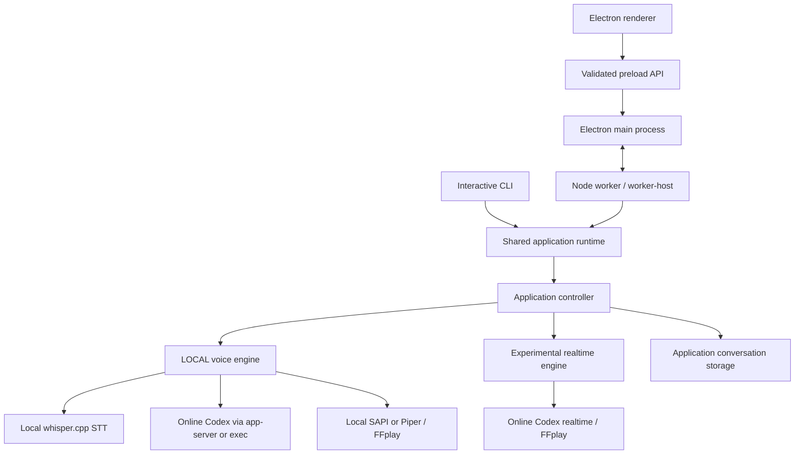

# Architecture

[Overview and setup](../README.md) · [Configuration and behavior](CONFIGURATION.md)

Voice Line runs TypeScript directly in Node using type stripping. The Electron main process owns native windows, tray, clipboard, image import and screen selection; a separate Node worker owns the conversation and voice services. The terminal hosts the same runtime without Electron.

Typed questions use the text backend in either voice mode and stay silent. Normal app-server text turns stream structured replies; LOCAL speech queues complete prose sentences while generation continues. Cancellation stops generation and speech, with committed or already spoken fragments retained according to the operation state.

## Data and trust boundaries

The default root is `%LOCALAPPDATA%\VoiceLine`, with an `APP_DATA_DIR` override. Application history, image artifacts and the Electron profile are local files, not encrypted by this application. LOCAL and ImageGen use separate application storage directories while reusing the existing Codex account/configuration. Realtime has its own Codex home for API-key authentication. The exact retention and recovery rules are in the [configuration reference](CONFIGURATION.md#conversation-storage-and-retention).

LOCAL keeps speech recognition and synthesis on the computer; transcripts, conversation context and explicit image attachments go to the online Codex backend. Realtime sends utterance audio online too. Text turns enable live web search. The read-only Codex sandbox restricts filesystem writes, but the process still uses the account's configured tools and MCP integrations; it is not a separate trust boundary for that account.

Storage coordination and activity leases live in process memory. Run one application host per data directory: do not run the desktop app and CLI against the same `APP_DATA_DIR` simultaneously. For independent sessions, configure distinct data roots before launch. Atomic file replacement protects individual writes; it does not provide a cross-process transaction lock.

The microphone stays open in interactive voice mode to avoid device startup delay; samples outside a held question are discarded. Question WAV files are normally temporary and deleted after processing. `SAVE_AUDIO=1` keeps those recordings, while `--debug` prints raw Codex protocol data to the terminal. Treat recordings, debug output, exports and application storage as private data.

## Module map

- `src/application-runtime.ts`: shared composition root for configuration, services, optional microphone and keyboard hook. `src/worker-main.ts` hosts it over Node IPC; `src/cli-main.ts` hosts it in the terminal. `src/main.ts` preserves older launch commands and `--debug-keys`.
- `src/application-controller.ts`: injected voice engine, optional recorder, clock and event sink; owns conversation operations, cancellation, reset, previous, history maintenance and shutdown. Text, recognition and playback initialize independently. Synchronous command admission returns an operation ID or rejection reason separately from asynchronous completion. Responses wait for the previous provider call and audio cleanup; stale callbacks cannot publish after reset or cancel.
- `src/application-input.ts`: shared Copilot tap/hold and keyboard-shortcut adapter. It translates physical input to controller operations and presentation intents; the controller knows neither physical keys nor desktop/CLI modes.
- `src/cli.ts`: terminal presentation, editable prompt, multiline input, history, export and service restart. It consumes the same authoritative events as the desktop and preserves draft text during asynchronous updates.
- `src/worker-host.ts`, `src/worker-validation.cjs` and `electron/engine-supervisor.cjs`: correlated IPC requests and admission acknowledgements, with bounded waits and rejection of pending requests on disconnect or restart. Electron clears a submitted draft only after worker acceptance; it does not synthesize operation states locally.
- `src/app-config.ts`: one immutable configuration snapshot for the selected services, passed by the factory to Codex, Whisper, recording and playback. Application hosts isolate audio-setting errors to their affected capabilities; strict diagnostic/factory loading still rejects invalid settings. LOCAL-only settings are not validated in realtime mode.
- `src/conversation-contract.ts` and `src/application-contract.ts`: neutral service interfaces, reply/history types, application command validation, service health and operation snapshot fields. Backend exports remain compatible adapters.
- `src/desktop-contract.ts` and `src/desktop-validation.cjs`: preload API, requests/events and runtime validation of renderer requests and worker snapshots. `electron/desktop-worker.cjs` dispatches validated events; `desktop-conversation.cjs` presents authoritative completed/pending exchanges; `desktop-windows.cjs` applies native geometry and window lifecycle.
- `src/answer-format.js`, `src/app-data.cjs`, `src/image-files.cjs` and `src/conversation-export.cjs`: shared formatting, data-root resolution, validated image access and portable conversation export, independent of Electron. Renderer/host imports retain thin compatibility adapters.
- `src/keyboard/bridge.ps1`: a small Win32 low-level keyboard hook bridge. It emits physical DOWN and UP events as JSON lines. `src/keyboard/copilot-key.ts` reads them in Node.
- `src/audio/recorder.ts`: FFmpeg opens the microphone at startup and streams 16 kHz mono PCM. Samples are kept only while Copilot is held; release writes a WAV immediately. This keeps the microphone in use while the app runs, even between utterances. Set `FFMPEG_BIN` to the real executable if your `ffmpeg.exe` on `PATH` is a launcher such as Chocolatey's shim. When `FFPLAY_BIN` is unset, playback prefers the real `ffplay.exe` beside that configured FFmpeg. This allows Copilot interruption to terminate the actual player instead of leaving it running behind a launcher. An explicit `FFPLAY_BIN` must also point to the actual executable.
- `src/stt/transcriber.ts`: local whisper.cpp server loaded once at startup. The model stays in memory between utterances; `STT_MODE=cli` in `.env` restores the old per-utterance CLI mode for troubleshooting.
- `src/codex-app-server.ts`: keeps [Codex app-server](https://learn.chatgpt.com/docs/app-server) running, reads saved history, resumes conversations, and sends each question as a structured-output turn. See the [backend settings](CONFIGURATION.md#backend-and-model-settings) for model and reasoning configuration.
- `src/codex.ts`: shared Polish assistant instructions and the optional `CODEX_MODE=cli` answer backend, using `codex exec --ephemeral` and an app-server connection for history.
- `src/conversation-session.ts` and `src/conversation-history.ts`: session metadata, two-minute expiry, previous-conversation restoration, and paginated Codex history loading.
- `src/speaker.ts`: prewarms a Windows SAPI voice when the app starts and keeps the PowerShell worker between answers. A new key press interrupts speech and starts a fresh worker while recording. Speaking rate defaults to `2` on SAPI's `-10` to `10` scale; set `TTS_RATE=0` in `.env` for the former pace.
- `src/piper-speaker.ts`: optional local Piper voice streamed to FFplay. Each utterance starts a Piper process; a new key press stops both Piper and FFplay.

App-server answers appear incrementally while their structured JSON is decoded.
For LOCAL voice questions, SAPI/Piper read complete prose sentences before the
whole response finishes, using one sequential queue. Fenced code is skipped;
code-only replies direct you to the panel after generation completes. ImageGen
speech waits for verified results. Typed questions remain silent. The `exec`
backend keeps final-only replies; native realtime audio uses its own stream.
Cancelling stops queued speech and inference. A speech failure leaves the complete
text available; a generation failure after playback retains an interrupted fragment.
If final text differs from the preview, speech stops and the corrected text is shown.
To inspect a bad transcription, add `SAVE_AUDIO=1` to `.env`; the terminal prints
the saved WAV path. Recordings are created in the system temporary directory and
normally deleted after processing. Remove the option afterward to avoid
accumulating recordings.

Debug mode also prints captured WAV duration and sound levels (RMS and peak in dBFS). Compare WAV duration with the key-hold time to spot missing audio. Codex timing is split into request acceptance and turn completion. The Whisper server is bound to `127.0.0.1` and loads the model once.

The Windows microphone-in-use icon is expected while the app runs: FFmpeg keeps
the device open, discarding samples outside recording. A local measurement on
2026-10-25 found a median 876 ms from FFmpeg launch to first PCM (5 launches),
versus 22 ms to the next PCM on an open stream (40 samples), about 854 ms saved
at recording start. This does not measure STT, inference or playback latency.
